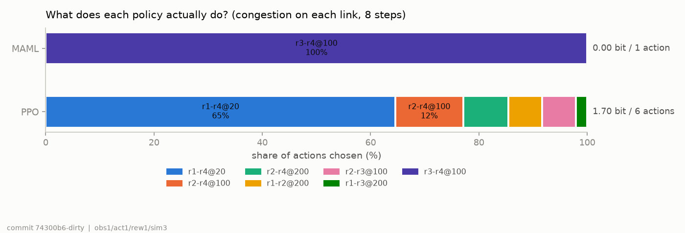
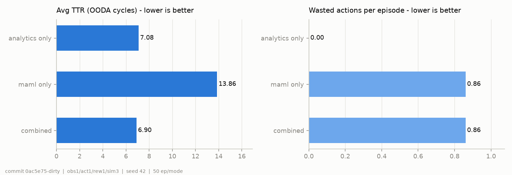

# 결과 요약 — ZSM 폐쇄 루프에서 규칙 · 계획기 · 학습 정책은 각각 무엇을 푸는가

> 2026-11-20 작성. 2026-11-14 ~ 11-18의 실험을 한곳에 모은 문서다. 실험을 진행하며 적은 기록은
> `cowork/ROADMAP.md` §6(실험 노트)에 날짜순으로 있다.
> **이 문서의 표는 손으로 쓰지 않는다** — `<!-- AUTO:… -->` 구간은 `experiments/make_results_tables.py`가
> `experiments/results/*.json`에서 생성하고, `scripts/selftest.sh`가 `--check`로 결과 파일과 대조한다.
> 표 밖 본문의 수치는 각 절에 적은 결과 파일과 ROADMAP §6에서 옮겼다.

## 0. 한눈에

**질문.** ETSI ZSM 폐쇄 루프(관측 → 분석 → 결정 → 실행)에서 장애 복구가 실패하는 원인은 무엇이고,
학습 기반 지능 계층(강화학습)은 규칙이나 모델 기반 계획기가 못 푸는 것을 푸는가?

**답.** 실패는 세 계층으로 나뉘고, 각각을 푸는 것은 학습이 아니었다.

- **진단 실패**는 관측 단위의 문제다 — 노드 지표 대신 링크를 직접 보면 풀린다.
- **조치 실패**는 탐색의 문제다 — 고장 링크 격리 한 가지로는 안 되고 여러 링크의 cost를 함께 바꿔야
  하는데, 라우팅 모델로 탐색하면 풀린다. 전수 탐색이 불가능한 규모(Abilene, 6×10^9 배치)에서도
  국소 탐색으로 충분했다.
- **모델 불일치**(수요가 바뀜)는 관측 부하로 모델을 다시 추정하면 풀린다.
- **학습 정책**(MAML, PPO)은 두 규모 모두에서 규칙 수준을 넘지 못했고, 계획기가 놓친 에피소드를 하나도
  풀지 못했다.

<!-- AUTO:headline -->
| 실험 | 모델 없는 규칙 | 모델 기반 계획기 | 학습 정책 |
| --- | --- | --- | --- |
| 4노드 단일 혼잡 (50 ep) | 성공 100 %, TTR 7.08 | — | MAML 단독 14 % |
| 4노드 용량·이중 혼잡 (풀이 있는 51 시나리오) | v1 18, v2 26 | 49 | — |
| 4노드 수요 변화 (450 ep) | 89 | 고정 229 · 적응형 432 | — |
| Abilene (풀이 있는 187 ep) | 155 | 183 | PPO 21.0 (사전 등록) · 152.4 (사후 변형) |
<!-- /AUTO:headline -->

## 1. 연구 질문과 가설

| 가설 | 내용 | 결과 | 근거 |
| --- | --- | --- | --- |
| H1 | 단일 혼잡·용량 제약 없음 → 규칙만으로 충분하다 | **지지** | §3 |
| H2 | 용량 제약·다중 혼잡 → 풀이가 있는데도 규칙이 실패하는 시나리오가 존재한다 | **지지** — 풀이 있는 51개 중 규칙 v1은 18개 | §4 |
| H3 | 그 구간에서 학습 정책이 규칙·계획기보다 낫다 | **기각** (이 설정에서) — 4노드에서는 여지가 4 %, Abilene에서는 여지 2~3 %에 학습 정책이 규칙 수준 | §5, §6 |

## 2. 공통 조건

**시뮬레이터.** 링크 스트레스 모델(`simulation/metric_generator.py`, 4노드 완전그래프 K4)과 같은
물리를 임의 토폴로지로 일반화한 `simulation/netsim.py`(Abilene). OSPF cost 최단경로(ECMP 경로 단위
균등 분배)로 수요를 싣고, 용량 모드에서는 이용률이 스트레스를 정하며 이용률 > 1이면 과부하가 붙는다.
혼잡 링크는 **실린 부하가 0이어야** 격리된다. 노드 SLA: 지연 < 50 ms, 손실 < 1 %.

**측정 경로의 동등성.** 4노드 실험은 HTTP 폐쇄 루프(`/auto-step`), Abilene 실험은 in-process
하네스로 돌렸다. 두 경로가 같은 것을 재는지 확인했다:

- `netsim`은 K4에서 `metric_generator`와 노드·링크 관측이 반올림 자릿수까지 같다 (30 에피소드 × 25틱)
- in-process 하네스는 `capacity_probe_v2.json`(HTTP 폐쇄 루프) 255 에피소드를 재생해 복구 여부·TTR·조치
  열이 **255/255** 같다 (`python3 experiments/scale_benchmark.py --validate-k4`)
- Abilene 라우팅은 경로 열거와 최단경로 개수(DP) 두 독립 구현이 무작위 배치 300개에서 일치한다
- 탐색 오라클은 K4 무작위 상태 120개에서 전수 탐색과 **120/120** 일치한다

**복구 판정은 실험마다 다르다** (각 실험 전에 정했다).

| 실험 | 판정 |
| --- | --- |
| §3 단일 혼잡 | 15 사이클 안에 (2번째 사이클 이후) 전 노드 SLA 충족을 처음 관측 = 성공, 그 사이클 = TTR |
| §4 용량·이중 혼잡 | 위와 같이 복구한 뒤 10 사이클을 더 돌려 마지막 사이클에도 SLA 충족 = stable |
| §5 수요 변화, §6 Abilene | 30 사이클 고정, 마지막 5 사이클 중 4번 이상 전 노드 SLA 충족 = stable |

**풀이 존재(오라클).** 노이즈 없는 정상상태에서 SLA를 만족하는 cost 배치가 있는가. 4노드는 15,625개
전수 탐색, Abilene은 탐색 기반(예산 30,000 평가). 주 지표는 **풀이 있는 시나리오**만 센다 — 풀이가
없는 시나리오에서의 실패는 제어기의 실패가 아니다.

## 3. 실험 1 — 4노드 단일 혼잡: 규칙만으로 충분하다 (H1)

<!-- AUTO:ablation -->
| 구성 | 평균 TTR (사이클) | 성공률 | 정상 링크 cost 변경/ep |
| --- | --- | --- | --- |
| 규칙(Analytics) 단독 | 7.08 | 100 % | 0.00 |
| 규칙 + MAML | 7.00 | 100 % | 0.68 |
| MAML 단독 | 13.86 | 14 % | 0.34 |

규칙 + MAML 폐쇄 루프 스트레스 시험 50 ep: 평균 TTR 6.88 (TEST 링크 6.75 / TRAIN 링크 7.11), 성공률 100 %, 근본 원인 첫 진단 정확도 100 %.

출처: `results/ablation_study.json` (커밋 `25feed0-dirty`), `results/stress_50ep.json` (커밋 `25feed0-dirty`)
<!-- /AUTO:ablation -->

- 규칙 단독과 규칙 + MAML의 TTR이 같고, MAML은 정상 링크의 cost만 더 바꾼다. 학습 계층의 기여는 0
  또는 음(−)이다.
- MAML 단독 성공 14 %는 붕괴한 상수 행동(`r3-r4@100`)이 정답과 우연히 일치한 에피소드다
  (부록 A, `cowork/AUDIT_2026-09-09.md` P8).
- TTR 약 7 사이클은 시뮬레이터의 물리 하한(cost 적용 후 4틱 + 관측 지연)에 가깝다.
- 이 두 결과 파일은 `-dirty` 표시 수정(2026-11-14) 전에 만들어졌다. 그 표시는 측정 코드가 커밋과
  달랐다는 뜻이 아니다 (§9).

## 4. 실험 2 — 4노드 용량·이중 혼잡: 기준선 사다리 (H2)

링크에 용량을 주고(공칭 부하의 2배, 약한 링크 1.2배) 혼잡 조합 21개 × 용량 프로파일 7개 = 147
시나리오, 시나리오당 5 seed. 풀이가 있는 51개만 센다.

<!-- AUTO:capacity -->
| Analytics | 진단 | 조치 | 시나리오 완전 해결 | 에피소드 안정 복구 |
| --- | --- | --- | --- | --- |
| v1 | 노드 지표로 링크 추정 | 원인 링크 cost 100 | 18 / 51 | 90 / 255 |
| v2 | 링크를 직접 관측 | 고장 링크만 cost 100 | 26 / 51 | 134 / 255 |
| v3 | v2와 같음 | 라우팅 모델로 cost 배치 15,625개 전수 탐색 | 49 / 51 | 253 / 255 |

출처: `results/capacity_probe.json` (커밋 `8e3d8cd`), `results/capacity_probe_v2.json` (커밋 `0a684a0`), `results/capacity_probe_v3.json` (커밋 `6ee4b83`)
<!-- /AUTO:capacity -->

<!-- AUTO:capacity_segments -->
| 구간 (시나리오 수) | v1 | v2 | v3 |
| --- | --- | --- | --- |
| 단일 혼잡 · 균일 용량 (6) | 30/30 | 30/30 | 30/30 |
| 단일 혼잡 · 약한 링크가 우회 경로 밖 (12) | 60/60 | 60/60 | 60/60 |
| 단일 혼잡 · 약한 링크가 우회 경로 위 (24) | 0/120 | 0/120 | 119/120 |
| 서로 떨어진 이중 혼잡 (9) | 0/45 | 44/45 | 44/45 |
<!-- /AUTO:capacity_segments -->

- **진단 실패는 관측의 문제였다.** 서로 떨어진 두 링크가 혼잡하면 네 노드가 전부 위반이라 노드 지표로는
  어느 링크인지 가릴 수 없다(v1: 0/45). 링크를 직접 보면(v2) 규칙을 바꾸지 않고도 44/45가 풀린다.
  v2는 정상 링크를 건드리지 않는다(v1은 풀이 있는 시나리오에서 에피소드당 2.05회).
- **조치 실패는 규칙으로 안 풀린다.** 약한 링크가 우회 경로 위에 있으면 고장 링크를 격리하는 순간 우회
  트래픽이 약한 링크를 포화시킨다. 풀이는 링크 4개의 cost를 함께 바꾸는 것이고, v2도 0/120이다.
  라우팅 모델로 탐색하는 계획기(v3)는 119/120을 푼다.
- 안정 판정에서 빠진 v3 2 에피소드와 v2 1 에피소드는 조치가 옳았고, 이용률이 정확히 1.0인 배치에서
  회복 막바지에 손실이 SLA를 한 사이클 넘었다(관측 노이즈).
- 풀이 없는 96개 시나리오에서는 어떤 제어기도 복구하지 못했다 — 한 노드의 링크 둘이 혼잡하면 그 노드의
  수요가 남은 링크 하나의 용량을 넘는다.

## 5. 실험 3 — 4노드 수요 변화: 낡은 모델은 모델이 없는 것과 같다

계획기는 에피소드가 균일 cost에서 시작하므로 첫 사이클에 수요를 정확히 읽는다. 그 가정을 깼다: 계획기가
조치를 시작한 뒤(3번째 사이클 직후) 한 쌍의 수요가 2배가 된다. 변화 뒤에도 풀이가 있는 150개 시나리오,
3 seed, 30 사이클.

<!-- AUTO:demand_shift -->
| 구간 (시나리오 / 에피소드) | v2 규칙 | v3 고정 계획기 | v4 적응형 계획기 |
| --- | --- | --- | --- |
| 수요 변화가 원래 계획을 깬다 (72 / 216) | 0 | 0 | 203 |
| 원래 계획 유지 · 기반이 규칙으로 풀림 (30 / 90) | 89 | 89 | 89 |
| 원래 계획 유지 · 기반에 계획기 필요 (48 / 144) | 0 | 140 | 140 |
| **합계** (150 / 450) | **89** | **229** | **432** |

출처: `results/demand_shift_v2.json` (커밋 `b045171`), `results/demand_shift_v3.json` (커밋 `b045171`), `results/demand_shift_v4.json` (커밋 `b045171`)
<!-- /AUTO:demand_shift -->

- **수요 추정을 고정한 계획기(v3)는 계획이 깨지면 규칙과 똑같이 0이다.** 자기 모델로는 현재 배치가
  만족스러워 아무것도 하지 않는다.
- **관측 부하가 모델과 어긋날 때 수요를 다시 추정하는 계획기(v4)는 216 중 203을 푼다.** 재추정은 관측
  부하를 설명하는 수요 중 이전 추정에 가장 가까운 것(의사역행렬)이며 정확한 복원이 아니다.
- v4와 오라클의 차이 18 에피소드 중 5개는 노이즈 경계, 13개(2.9 %)가 수요 추정 오류로 틀린 배치에
  도달한 것이다. **4노드에서 학습 정책이 v4보다 나아질 수 있는 여지는 최대 4 %다.**
- v4의 설계는 벤치마크 전에 점검용 시나리오 하나에서 한 번 고쳤다(추정 수요로 풀이가 없으면 가만히 있지
  않고 가장 덜 나쁜 배치로 움직이도록). 벤치마크 결과를 보고 고친 것은 없다.

## 6. 실험 4 — Abilene 규모 확장: 학습 정책과 계획기의 정면 비교 (H3)

**왜.** 4노드에서 계획기가 강한 이유는 (1) 전수 탐색이 가능하고 (2) 링크 부하가 정확히 보이기
때문이었다. Abilene(11노드 · 14링크 · 55쌍)은 cost 배치가 5^14 ≈ 6.1×10^9개라 (1)이 깨진다.

**프로토콜 (TEST를 돌리기 전에 커밋).** 시나리오 = 혼잡 1~2개 × 약한 링크 없음/1개 × 3사이클 뒤 핫스팟
(한 노드의 모든 쌍 수요 ×2) 없음/1개. 시나리오 키의 해시로 TRAIN 80 % / TEST 20 %. TEST 400 에피소드,
모든 제어기가 같은 에피소드·같은 노이즈. 계획기는 국소 탐색(예산 3,000 평가), 오라클은 같은 엔진에 예산
30,000. PPO는 SB3 기본값 + 정책·가치망 [128, 128] + 엔트로피 0.01, 관측 64차원(링크 이용률·손실 포함),
행동 71개(무행동 포함), 보상 v2 = −(SLA 위반 노드 비율) − 0.02 × [cost 변경], seed당 300k 스텝, seed 5개.
TRAIN 파일럿에서 한 가지를 고쳤다: 참 수요 계획기에만 best-effort가 없어 정확한 풀이가 없으면 규칙으로
물러났다 — 두 계획기가 수요를 아느냐 하나만 다르도록 맞췄다.

<!-- AUTO:scale -->
| 제어기 | 안정 복구 (풀이 있는 187) | 비율 | 수요 변화 있음 (51) | 이중 혼잡 (16) | 결정 시간 |
| --- | --- | --- | --- | --- | --- |
| 무행동 | 0 | 0.0 % | 0 | 0 | — |
| 규칙 v2 | 155 | 82.9 % | 35 | 8 | 0.004 ms |
| 계획기 (참 수요) | 182 | 97.3 % | 47 | 15 | 12.5 ms |
| 계획기 (추정 수요) | 183 | 97.9 % | 48 | 15 | 12.3 ms |
| PPO 사전 등록 (보상 v2), seed 0–4 | 0 / 0 / 38 / 46 / 21 | 11.2 % ± 11.3 | 2.8 | 1.2 | 0.24 ms |
| PPO 사후 변형 (보상 v3, 풀이 있는 시나리오만), seed 0–4 | 155 / 147 / 143 / 158 / 159 | 81.5 % ± 3.8 | 33.8 | 7.4 | 0.19 ms |

출처: `results/scale_benchmark.json` (커밋 `7dc16da`), `results/scale_benchmark_ppo_r3.json` (커밋 `8b4b10f`)
<!-- /AUTO:scale -->

<!-- AUTO:scale_overlap -->
| 에피소드 단위 비교 (풀이 있는 에피소드) | 수 |
| --- | --- |
| 계획기(추정 수요)가 놓친 에피소드 | 4 |
| 그중 PPO 사후 변형 seed 하나라도 푼 것 | 0 |
| 규칙이 푼 에피소드 | 155 |
| 그중 PPO 사후 변형 seed 과반(≥3)이 푼 것 | 155 |
| 규칙은 못 풀고 PPO 사후 변형 seed 하나라도 푼 것 | 4 |
<!-- /AUTO:scale_overlap -->

- **규모를 키워도 탐색이 이긴다.** 링크 하나씩 바꾸는 국소 탐색이 풀이 있는 에피소드의 98 %를 푼다.
  오라클이 풀이 없다고 한 213 에피소드에서는 어떤 제어기도 복구하지 못했고, 오라클 예산을 10배로
  늘리면 그중 2개가 풀이 있음으로 바뀐다 — 계획기와 오라클의 차이는 **4~6 에피소드(2~3 %)**다.
- **추정 수요가 참 수요만큼 좋다.** 공칭 수요에서 출발해 관측 부하로 다시 추정하는 계획기(183)가 참 수요를
  아는 계획기(182)와 같다. §5의 결론이 규모에서도 유지된다.
- **사전 등록한 PPO는 학습 신호 때문에 실패했다.** TRAIN 시나리오에서도 실패했다(일반화 문제가 아니다).
  TRAIN 시나리오의 약 70 %가 풀이 없고, 거기서는 무행동이 링크를 격리하는 것보다 위반 노드를 덜 만든다 —
  보상 v2로 재면 무행동(−7.20)과 규칙(−7.21)이 같다. PPO는 무행동 수준에도 못 미쳤다(−7.7 ~ −7.95).
- **보상을 평가 지표에 맞추면 PPO는 규칙을 배운다.** 사후 변형(보상 v3 = 전 노드 SLA 충족이면 +1,
  풀이 있는 TRAIN 시나리오로만 학습)은 규칙 수준이고, 규칙이 푼 에피소드는 거의 모두 풀지만 **계획기가
  놓친 에피소드는 하나도 못 푼다.** 배운 것은 "고장 링크 격리"이고 여러 링크의 동시 조정은 배우지 못했다.
- **사후 변형은 사전 등록 결과를 본 뒤 설계했고 같은 TEST 400 에피소드로 평가했다.** 결과가 학습 정책에
  유리하지 않아 결론의 방향은 같지만, 그 수치를 사전 등록 수치처럼 인용하면 안 된다.
- 학습 정책이 계획기보다 나은 것은 결정 시간 하나인데, 사이클이 초 단위인 이 문제에서는 의미가 없다.
- 체크포인트는 같은 커밋에서 다시 학습하면 가중치가 비트 단위로 같다(사전 등록 5개로 확인).

## 7. 종합 — 실패의 계층 분해

| 실패 | 증상 | 원인 | 푼 것 | 근거 |
| --- | --- | --- | --- | --- |
| 진단 실패 | 엉뚱한 링크를 격리, 정상 링크 cost 변경 | 노드 평균 지표로는 링크가 가려지지 않는다 | **링크 단위 관측** (규칙은 그대로) | §4 v1 → v2: 이중 혼잡 0/45 → 44/45 |
| 조치 실패 | 격리 후 우회 링크 포화, 연쇄 위반 | 정답이 여러 링크의 동시 변경이다 | **라우팅 모델 + 탐색** | §4 v2 → v3: 0/120 → 119/120, §6 규칙 155 → 계획기 183 |
| 모델 불일치 | 계획기가 "만족"이라 믿고 멈춤 | 수요가 바뀌었는데 모델은 그대로다 | **관측 부하로 모델 재추정** | §5 v3 → v4: 0/216 → 203/216 |
| (학습 정책) | — | — | 규칙 수준, 계획기의 실패는 못 품 | §3, §6 |

## 8. 이 결과가 말하지 않는 것

- **시뮬레이션이다.** 실제 패킷·SNMP·OSPF 데몬은 없다. 스트레스 모델은 이 프로젝트가 정한 것이고,
  계획기는 시뮬레이터와 같은 라우팅 모델을 쓴다(§4·§5에서는 상한선 역할). 실환경(Mininet + FRR)
  검증은 하지 않았다.
- **토폴로지 두 개(K4, Abilene), 용량 규약 하나(공칭 부하 2.0배 / 약한 링크 1.2배).** 상수는 실험 전에
  정했고 결과를 보고 바꾸지 않았다.
- **학습 정책은 MAML(4노드)과 PPO(MLP, 300k 스텝) 두 가지다.** 그래프 신경망, 더 긴 학습, 계획기 시연을
  이용한 모방 학습은 재지 않았다. "학습이 못 한다"가 아니라 "이 설정의 학습 정책이 못 했다"이다.
- **Abilene 오라클은 탐색 기반이다.** "풀이 없음"은 증명이 아니라 추정이다(예산 10배에서 213 중 2개가
  뒤집혔다).
- **수요 변화는 한 형태씩만 쟀다** (4노드: 한 쌍 2배, Abilene: 한 노드 2배, 둘 다 3사이클 뒤 한 번).
  여러 쌍이 동시에 또는 서서히 변하는 경우, 용량·토폴로지 정보가 틀린 경우는 재지 않았다.
- **ZSM 범위.** 단일 관리 도메인의 폐쇄 루프다. 다중 도메인·E2E 서비스 관리와 ENI 기능 블록(API 브로커,
  정책 관리)은 구현하지 않았다 (`cowork/PROJECT_OVERVIEW.md` §8).

## 9. 재현

```bash
# 표 재생성 / 대조
python3 experiments/make_results_tables.py --write
python3 experiments/make_results_tables.py --check

# §3 (기본 시뮬레이터; 서버 두 개를 먼저 띄운다 — PROJECT_OVERVIEW §5.2)
python3 experiments/ablation_study.py
python3 experiments/stress_test.py --episodes 50

# §4·§5 (SIM_CAPACITY=finite로 가상 장비를 띄운다)
python3 experiments/capacity_probe.py
python3 experiments/capacity_probe.py --analytics-version 2 --solvable-only --output capacity_probe_v2.json
python3 experiments/capacity_probe.py --analytics-version 3 --solvable-only --output capacity_probe_v3.json
python3 experiments/demand_shift_probe.py --analytics-version 4   # 2, 3도 같은 방식

# §6 (서버 불필요)
python3 experiments/scale_benchmark.py --validate-k4
python3 experiments/train_scale_ppo.py --seed 0                    # seed 0~4
python3 experiments/scale_benchmark.py --ppo ai-engine/agents/scale/ppo_abilene_s{0,1,2,3,4}.zip
python3 experiments/abilene_solvable_table.py                      # 사후 변형용
python3 experiments/train_scale_ppo.py --seed 0 --reward-version 3 --solvable-only
python3 experiments/scale_benchmark.py --controllers "" --output scale_benchmark_ppo_r3.json \
    --ppo ai-engine/agents/scale/ppo_abilene_r3_solv_s{0,1,2,3,4}.zip
```

모든 결과 JSON 머리에 측정 조건·seed·커밋·계약 버전이 있다(`experiments/_resultmeta.py`).
2026-11-14 이전의 결과 파일은 커밋 해시에 항상 `-dirty`가 붙어 있다 — 스크립트가 결과 파일을 연 뒤에
해시를 읽었기 때문이며, 코드 상태에 대해서는 아무것도 말해 주지 않는다(2026-11-14 수정).

---

## 부록 A. 2026-09 측정 — README 2026-11-18판 '성능 검증' 절 원문

> 11월 연구 질문을 정하기 전의 측정이다. 4노드 기본 시뮬레이터(용량 없음), 규칙 v1 + MAML/PPO.
> 철회한 수치(TTR 3.78, "98.1 % 단축")와 그 경위를 그대로 남긴다. 아래 본문은 고치지 않았다(제목
> 단계와 이미지 경로만 조정).

### 성능 검증

측정 경로가 두 가지이고 **서로 직접 비교할 수 없다.** 인용 시 어느 경로인지 밝힐 것.

| 경로 | 실행 | Analytics override | 타임아웃 |
| ---- | ---- | ------------------ | -------- |
| 폐쇄 루프 | `POST /auto-step` | 포함 | 15 사이클 |
| 오프라인 평가 | `experiments/run_experiment.py` | 없음 (정책 단독) | 200 스텝 |

#### 1. 폐쇄 루프 — 자동 대응 속도 (50 에피소드, `/auto-step`)

**2026-09-13 재측정 (사이클당 1틱, 시뮬레이터 시드 고정, seed 42, `results/stress_50ep.json`)**

| 시스템 | Avg TTR | 성공률 | RCA 정확도 (첫/전 사이클) | 부수 피해/ep |
| ------ | ------- | ------ | ------------------------- | ------------ |
| **본 시스템 (MAML + ZSM Analytics)** | **6.88** (TEST 6.75 / TRAIN 7.11) | **100%** | 100% / 100% | 0.70 |

> 최단경로 라우팅 도입(`SIM_VERSION = 3`, ROADMAP B-1) 후, 시뮬레이터 난수까지 시드한 값이다.
> 라우팅 도입 전(cost 역수 근사, sim_v2)에는 6.84 (TEST 6.69 / TRAIN 7.11)였다 — 우회에 대가를 만들어도 폐쇄 루프 TTR은
> 사실상 그대로다. TTR을 정하는 것은 혼잡 링크 격리와 감쇠 대기이기 때문이다.

부수 피해(정상 링크의 cost가 실제로 바뀐 횟수)는 전부 MAML의 2번째 이후 행동이다.

**개정 전 수치 (사이클당 2틱 — 직접 비교 불가, `results/stress_50ep_pre_audit.json`)**

| 시스템 | Avg TTR | 성공률 | RCA 정확도 |
| ------ | ------- | ------ | ---------- |
| MAML v2 + ZSM Analytics | 3.78 | 100% | 100% (첫 사이클만) |
| MAML v1 (Analytics override 이전) | 12.41 | 96.7% | N/A |

측정 스크립트가 `/auto-step` 뒤에 검증용 `/metrics`를 읽을 때마다 시뮬레이터가 1틱 더 흘렀다.
RCA는 2번째 사이클부터 정상 링크를 지목했으나 "첫 사이클 정확도"만 재서 드러나지 않았다.
학습에 없던 링크(TEST)에서도 같은 TTR이지만, 이는 규칙 기반 Analytics의 성질이지 학습 일반화가 아니다.

#### 2. 오프라인 평가 — 에이전트 정책 단독 비교 (TEST 링크)

**최신 (2026-09-13, `SIM_VERSION = 3`, TEST 링크 held-out, seed 42, `results/offline_eval.json`)**

| 에이전트 | Avg TTR | 성공률(TTR<30) | 정책 검사 |
| -------- | ------- | -------------- | --------- |
| Baseline PPO (50,000 steps) | **200.0** | **0%** | 붕괴 아님 (행동 6종, 최빈 0.46, 1.65 bit) |
| MAML (샘플링 롤아웃, 500 iter) | **101.93** | **50%** | **붕괴** (상수 `r3-r4@100`, 0 bit) |



*각 링크에 혼잡을 주입하고 8스텝씩 관측한 행동 분포. MAML은 한 덩어리(행동 1종), PPO는
여러 조각으로 갈린다. 재현: `python ai-engine/policy_check.py`*

**어느 쪽도 혼잡 링크를 찾는 정책이 아니다.** MAML의 성공 50%는 상수 행동 `r3-r4@100`이 TEST 링크
둘 중 `r3-r4`와 우연히 일치하는 비율일 뿐이고, PPO는 행동이 다양해졌지만 그중 TEST 링크가 필요로 하는
행동이 없어 양쪽 다 타임아웃한다. 즉 **"붕괴하지 않은 정책"과 "푸는 정책"은 다르다**
(`cowork/ROADMAP.md` §5).

**직전 측정 (sim_v2, `results/*_pre_b1.json`)**: PPO 101.8 / 50%, MAML 101.8 / 50%, 개정 전
MAML 체크포인트 188.6 / 6%. 당시 두 에이전트가 동등해 보였던 것은 **학습에 TEST 링크가 섞여 있었기
때문**이며(2026-09-09 발견·수정), 링크를 실제로 분리하자 200.0 vs 101.81로 갈렸다.

**개정 전 수치 (스텝당 2틱 — 직접 비교 불가)**

| 에이전트 | Avg TTR | 성공률(TTR<30) | 평균 보상 |
| -------- | ------- | -------------- | --------- |
| Baseline PPO (미학습·랜덤) | 200.0 | 0% | 59.7 |
| Baseline PPO (50,000 steps 학습) | 100.9 | 50% | 91.1 |
| MAML (Analytics 미적용) | 139.7 | 32% | 78.0 |

> 미학습 행은 30 에피소드분(`results/summary.json`), 학습 PPO·MAML 두 행은 동일 조건
> 50 에피소드분(`results/offline_eval_trained_ppo_pre_audit.json`, 2026-09-06 실행).

**정정 (2026-09-06)**: 이전 README는 "Baseline 대비 98.1% 대응 시간 단축(200 → 3.78)"이라고
기술했으나, 이는 ① **미학습 랜덤 정책**과 비교한 것이고 ② **측정 경로가 다른** 두 수치를
한 축에 놓은 것이었다. PPO를 50,000 스텝 학습시켜 같은 오프라인 경로에서 재평가하면
**PPO(100.9)가 MAML(139.7)보다 오히려 빠르다.** 따라서 이 주장은 철회한다.

**그렇다면 3.78은 어디서 오는가** — Analytics override다. 아래 절제 실험이 이를 독립적으로
확인한다: Analytics 단독(3.88)이 통합(3.80)과 사실상 같고, MAML 단독은 12.32에 성공률 24%다.
즉 **성능의 동인은 MAML이 아니라 근본 원인 분석 계층**이며, MAML의 기여는 현재 데이터로는
확인되지 않는다.

#### Ablation Study — 위협 인텔리전스 계층의 기여

**2026-09-13 재실행 (사이클당 1틱, 에피소드별 seed 고정, `SIM_VERSION = 3`, `results/ablation_study.json`)**

| 모드 | Avg TTR | 성공률 | 부수 피해/ep | RCA 전 사이클 |
| ---- | ------- | ------ | ------------ | ------------- |
| Analytics(위협 인텔리전스)만 | **7.08** | **100%** | **0.00** | 100% |
| MAML만 | 13.86 | 14% | 0.34 | — |
| 통합 (본 시스템) | 7.00 | 100% | 0.68 | 100% |

sim_v2(우회가 공짜였던 모델)에서는 6.94 / 13.80 / 6.94였다 — 결론은 동일하고, 이제
**우회에 대가가 있는 시뮬레이터에서도** 통합이 Analytics 단독 대비 얻는 것이 없음이 확인된다.



*TTR과 부수 피해는 스케일이 달라 한 축에 얹지 않고 패널을 나눴다. 통합(combined)은 Analytics
단독과 TTR이 사실상 같고 정상 링크 cost 변경만 늘어난다.*

**복구는 전부 Analytics가 한다.** 통합은 Analytics 단독과 TTR이 같고 정상 링크 cost 변경만 0.86/ep
늘어난다 — 현재 MAML의 기여는 음(−)이다. MAML 단독 성공 14%는 상수 행동 `r3-r4@100`이 정답인
에피소드(7/50)뿐이다.

개정 전(2026-05-20, 사이클당 2틱): Analytics만 3.88/100%, MAML만 12.32/24%, 통합 3.80/100%
(`results/ablation_study_pre_audit.json`). 결론은 같다.

## 부록 B. README 2026-11-18판 — 다른 문서로 옮기지 않은 부분 전체 (원문 보존)

> 2026-11-20 재구성 직전의 README에서 개발 일지(→ `cowork/CHANGELOG.md`), '성능 검증' 절(→ 부록 A,
> CICDDoS2019 부분은 `cowork/SECURITY.md` §4), '탐지하는 위협' 1·2(→ `SECURITY.md` §1)를 뺀 나머지
> 전부다. 당시 첫 화면은 "위협 탐지 + MAML이 대응 결정"을 말하고 있었고, 11월의 연구 범위 절이 그 위에
> 덧붙어 있었다. 본문은 고치지 않았다(제목 단계와 상대 경로만 조정).

### vagus

#### 사람을 거치지 않는 네트워크 폐쇄 루프 — ETSI ZSM/ENI 기반 위협 탐지·자율 복구

> **vagus** — 미주신경. 자율신경계에서 의식적 판단을 거치지 않고 장기의 상태를 감지하고
> 조절하는 경로다. 관측 → 진단 → 조치 → 검증을 사람 없이 닫는다는 점에서 이 시스템이 하는
> 일과 같다.

---

#### 한 줄 요약

OSPF 라우팅 하이재킹과 DDoS/포트스캔을 탐지하고, ETSI ZSM/ENI 폐쇄 루프(OODA)로 사람 개입
없이 평균 **6.88 사이클** 안에 복구하는 시스템. 4노드 시뮬레이션 환경에서 50 에피소드 측정,
성공률 100%, 근본 원인 첫 진단 정확도 100%.

**복구를 이끄는 것은 규칙 기반 진단이다.** 강화학습(MAML/PPO) 층을 함께 구현하고 같은
조건에서 측정했지만 아직 기여가 확인되지 않았다 — 절제 실험에서 MAML 단독은 성공률 14%이고,
학습된 정책은 상태와 무관한 상수 행동으로 붕괴한다. 이 결과는 숨기지 않고 그대로 보고하며,
붕괴 여부를 학습 직후 자동 검사하는 게이트를 두고 있다.

---

#### 연구 범위 (2026-11-14 확정)

이 리포지토리는 양우석·이재오, "ZSM/ENI 기반의 자율 네트워크 및 서비스 관리"(KNOM Review 27(2),
2024)가 정리한 참조 구조 중 **ZSM 단일 관리 도메인의 폐쇄 루프**를 구현하고, 다음 질문에 답하는
것을 목표로 한다.

> 규칙 기반 Analytics가 근본 원인을 특정하지 못하거나 정해진 조치가 통하지 않는 조건에서,
> 학습 기반 Intelligence 계층이 복구에 기여하는가?

지금까지 확인된 것: 단일 혼잡에서는 규칙만으로 충분하다(아래 절제 실험). 링크에 용량을 주면
풀이가 있는 시나리오 51개 중 기존 규칙이 푸는 것은 18개, 링크를 직접 관측하는 규칙은 26개,
라우팅 모델로 탐색하는 계획기는 49개(나머지 2개도 조치는 옳다)다
(`results/capacity_probe*.json`, `cowork/ROADMAP.md` §6). 계획기는 시뮬레이터와 같은 모델을
가진 상한선이다.

계획기의 모델이 틀리는 조건도 쟀다(2026-11-16): 에피소드 도중 수요가 2배가 되면 수요 추정을
고정한 계획기는 계획이 깨지는 216 에피소드에서 0건, 관측 부하에 맞춰 수요를 다시 추정하는
계획기는 203건을 푼다. 전체 450 에피소드에서 적응형 계획기와 오라클의 차이는 18건(4 %)이다
(`results/demand_shift_v*.json`). **4노드 토폴로지에서는 학습 계층이 기여할 여지가 거의 없다** —
전수 탐색이 가능하고 링크 부하가 정확히 관측되기 때문이다.

규모를 키워도 같았다(2026-11-18): 전수 탐색이 불가능한 Abilene(11노드·14링크, cost 배치 6×10^9개)에서
국소 탐색 계획기는 풀이 있는 187 에피소드 중 183개를 풀고, 학습 정책(PPO, seed 5개)은 보상을 평가
지표에 맞춘 사후 변형에서도 평균 152개로 규칙(155개) 수준이다. 계획기가 놓친 4개를 푼 PPO seed는
없다 (`results/scale_benchmark*.json`, `cowork/ROADMAP.md` §6).

아래의 OSPF 위조·DDoS 탐지 절은 이 질문의 범위 밖이며, 구현과 측정 기록으로만 남긴다.

---

#### 배경 및 동기

5G/6G 환경에서 네트워크 위협은 더 정교해지고 빠르게 진화한다. 기존 보안 시스템은 탐지 후 사람이 직접 대응 절차를 수행하기 때문에, 공격 인지부터 차단까지 수분~수십 분의 대응 공백이 발생한다.

본 시스템은 이 공백을 제거한다.

- **위협 탐지**: OSPF 라우팅 레이어의 LSA 위조 공격, 트래픽 레이어의 DDoS/포트스캔을 AI로 실시간 식별
- **자동 대응**: 탐지 즉시 OSPF cost 재조정 또는 SDN OpenFlow 차단 룰을 자동 생성·적용
- **근본 원인 분석**: SLA 위반 노드의 인접도 점수로 문제 링크를 첫 사이클에 100% 식별

**핵심 연구 질문**

> 라우팅 레이어(OSPF LSA 위조)와 트래픽 레이어(DDoS/포트스캔)의 위협을 AI 단일 파이프라인으로 통합 탐지하고, 사람 개입 없이 평균 6.88 OODA 사이클(2026-09-13 재측정; 이전 3.78은 사이클당 2틱으로 잰 값) 내 자동 복구할 수 있는가?

---

#### 탐지하는 위협

##### 3. 네트워크 성능 이상 (SLA 위반)

SLA 규칙(지연 > 50 ms 또는 손실 > 1 %)으로 위반 노드를 잡고, 인접도 점수 기반 RCA로 근본 원인 링크를
자동 식별한다. `AnomalyDetector`(IsolationForest)는 Java 경로의 `/anomaly`에서만 판정에 쓰이며
**폐쇄 루프(`/auto-step`)의 Orient에는 관여하지 않는다** — 2026-09-09 감사에서 문서와 코드가
달랐던 부분을 정정했다 (`cowork/AUDIT_2026-09-09.md` P3).

---

#### 자동 대응 파이프라인 (OODA)

```
[Observe]   SNMP 메트릭 수집 + 보안 피처 추출
     ↓
[Orient]    위협 인텔리전스 분석
            ├─ OSPF LSA 위조 탐지    (ospf_security.py)
            ├─ 트래픽 공격 탐지      (SecurityAnomalyDetector)
            ├─ 성능 이상 탐지        (diagnose — SLA 규칙)
            └─ 근본 원인 분석 RCA    (root_cause_analysis, ZSM 분석 서비스)
     ↓
[Decide]    MAML few-shot 에이전트 — 최적 대응 행동 결정
            ├─ 라우팅 위협 → OSPF cost 재조정
            └─ 트래픽 공격 → OpenFlow 차단 룰 생성
     ↓
[Act]       대응 자동 실행 (사람 개입 없음)
     ↓
[Evaluate]  AI 모델 성능 자가 진단 + 재학습 필요 여부 판단
            (ZSM 지능 서비스 — 배포된 AI 모델 평가)
```

평균 대응 완료까지 **6.88 OODA 사이클** (50 ep, 2026-09-13 재측정, 시뮬레이터 시드 고정). 시뮬레이터의 물리 하한은 cost 적용 후
4틱이고 폐쇄 루프는 1틱 뒤 첫 관측 → 행동이므로 6~7사이클이 사실상 최선이다.
**이전 문서의 3.78은 측정 스크립트가 사이클당 시뮬레이터를 2틱 진행시켜 얻은 값이라 철회한다**
(`cowork/AUDIT_2026-09-09.md` P1, §3).

---

#### 시스템 아키텍처

##### 계층 구조

| 계층 | 역할 | 구현 |
| ---- | ---- | ---- |
| **Threat Intelligence** | 위협 탐지 + 근본 원인 분석 | `ospf_security.py` + `anomaly_detector.py` |
| **Intelligence** | 최적 대응 행동 결정 | MAML few-shot 에이전트 |
| **Orchestration** | 대응 자동 실행 | OSPF cost 조정 + OpenFlow 룰 |
| **Evaluation** | 모델 자가 진단 | `ModelPerformanceTracker` |

##### 상태·행동 공간

- **네트워크 상태** (14차원): `[대역폭×4, 지연×4, OSPF_cost×6]`
- **보안 피처** (3차원): `[syn_ratio, unique_src_count, pkt_rate]`
- **행동 공간** (30차원): `{10, 20, 50, 100, 200} × 6링크`

---

#### 프로젝트 구조

```
autonomous-network-mgmt/
├── simulation/
│   ├── metric_generator.py   # 네트워크 메트릭 + 공격 시뮬레이션 (DDoS/포트스캔)
│   └── mock_snmp_agent.py    # REST API + 공격 주입 엔드포인트
│
├── ai-engine/
│   ├── ospf_security.py      # OSPF LSA 위조 탐지 엔진
│   ├── topology.py           # 토폴로지 상수 단일 출처
│   ├── anomaly_detector.py   # SLA 진단 + RCA + IsolationForest(/anomaly 전용) + SecurityAnomalyDetector
│   ├── api_server.py         # FastAPI (위협 탐지·대응 엔드포인트 포함)
│   ├── reward.py             # 보상 함수
│   ├── environment/
│   │   └── network_env.py    # Gym 네트워크 환경
│   └── agents/
│       ├── baseline_drl.py   # Baseline PPO
│       └── few_shot_agent.py # MAML few-shot 에이전트
│
├── experiments/
│   ├── run_experiment.py
│   ├── ablation_study.py
│   └── results/
│
└── docker-compose.yml        # Kafka, PostgreSQL, Redis, Simulation
```

---

#### API

##### 위협 탐지 (포트 8000)

| 메서드 | 경로 | 설명 |
| ------ | ---- | ---- |
| `POST` | `/ospf/lsa-check` | LSA 위조 실시간 검사 |
| `GET` | `/ospf/security-status` | OSPF 위협 알림 이력 |
| `POST` | `/security/detect` | 트래픽 공격 탐지 + OpenFlow 차단 룰 반환 |
| `GET` | `/security/status` | 통합 보안 상태 조회 |
| `POST` | `/auto-step` | OODA 폐쇄 루프 1 사이클 실행 |
| `GET` | `/diagnose` | 근본 원인 분석 결과 조회 |

##### 공격 시뮬레이션 (포트 5001)

| 메서드 | 경로 | 설명 |
| ------ | ---- | ---- |
| `POST` | `/debug/attack/{type}` | 공격 주입 (`ddos` \| `portscan`) |
| `DELETE` | `/debug/attack` | 공격 중지 |
| `POST` | `/debug/fake-lsa` | 위조 LSA 주입 데모 |
| `GET` | `/metrics/security` | 보안 피처 포함 실시간 메트릭 (순수 조회) |
| `POST` | `/debug/tick` | 시뮬레이션 시간 1스텝 진행 — `/auto-step`이 사이클마다 호출 |
| `POST` | `/debug/reset` | 에피소드 리셋, body `{"seed": N}`으로 노이즈 재현 |

**시뮬레이션 시계 (2026-09-09).** 시간은 `POST /debug/tick`으로만 흐른다(`SIM_CLOCK=lockstep`, 기본).
메트릭 조회는 순수 조회라 대시보드·collector·실험 스크립트의 조회가 시뮬레이션을 가속하지 않는다.
주기적으로 관측만 하는 Java 경로 데모에는 `SIM_CLOCK=realtime:1000 python mock_snmp_agent.py`처럼
백그라운드 시계를 켠다. 이전에는 조회마다 시간이 흘러 실험 스크립트의 검증 조회가 사이클당 2틱을
만들었고, 보고된 TTR이 실제의 약 절반이었다 (`cowork/AUDIT_2026-09-09.md` P1).

**보안 범위.** `/debug/*`·`/reset-buffer` 등은 인증이 없고 CORS `*`, `0.0.0.0` 바인딩이며 OSPF 인증 키는
코드에 하드코딩되어 있다. 연구 데모 전용이며 외부 노출을 전제하지 않는다.

---

#### 핵심 기여

1. **네트워크 위협 통합 탐지**: 라우팅 레이어(OSPF LSA 위조)와 트래픽 레이어(DDoS/포트스캔)를 단일 AI 파이프라인으로 탐지
2. **Zero-Touch 자동 대응**: 탐지 → 대응 전 과정 자동화, 폐쇄 루프 평균 6.88 사이클 내 복구
   (물리 하한 대비 ~1.5배; 2026-09-09 재측정)
3. **위협 인텔리전스 + AI 융합**: 트래픽 공격 탐지(`SecurityAnomalyDetector`)에서 임계치 규칙과 비지도
   IsolationForest를 조합 — 단, 폐쇄 루프의 성능 이상 판정은 SLA 규칙만 사용한다 (2026-09-09 정정)
4. **성능 동인의 정량 규명**: 절제 실험과 베이스라인 재측정으로 복구 성능이 Analytics(RCA)
   계층에서 나오며 MAML의 추가 기여는 확인되지 않음을 실증 — 어느 계층이 실제로 일하는지를
   가린 것 자체가 결과다
5. **링크 무관 복구**: 학습에 없던 링크에서도 동일 TTR — 다만 이는 규칙 기반 Analytics의 성질이지
   학습 일반화의 증거가 아니다 (2026-09-09 정정)
6. **표준 기반 구현**: ZSM 폐쇄 루프와 분석·지능 서비스를 **단일 관리 도메인**에서 구현하고 절제
   실험으로 계층별 기여를 쟀다. 다중 도메인·E2E 서비스 관리, ENI 구조(API 브로커, 정책 관리)는
   구현하지 않았다 (2026-11-14 정정 — 이전의 "Clause 3.1.1.2~3.1.1.4 완전 구현"은 조항 번호도
   범위도 틀렸다. 대응표는 `cowork/PROJECT_OVERVIEW.md` §8)

---

#### 한계 및 향후 연구

##### 한계

- Mininet 시뮬레이션 기반 — 실제 하드웨어 환경 검증 필요
- **MAML의 기여가 확인되지 않음 — 오히려 음(−)** — 절제 실험에서 Analytics 단독(6.94)과 통합(6.94)의
  TTR이 같고 통합은 정상 링크 cost 변경만 0.86/ep 더 한다. 복구 성능은 근본 원인 분석 계층이
  만들어낸다 (위 "성능 검증" 절 참고)
- **정책 붕괴는 학습 초반에 일어난다** (2026-09-13) — 학습 중 행동 분포를 기록해 보니 MAML은
  전체의 24%(iter 120/500), PPO는 16%(8,192/50,000 스텝) 지점에서 붕괴한다. PPO는 회복하고
  MAML은 iter 260 이후 갇혀, **MAML 학습의 뒤쪽 절반은 이미 죽은 정책 위에서 돈다.**
  학습량을 늘리는 것으로는 해결되지 않는다 (`cowork/ROADMAP.md` §5, 도판 `T1_train_collapse`)
- **학습된 정책이 혼잡 링크를 찾지 못한다** (2026-09-09) — MAML은 상수 `r3-r4@100`으로 붕괴해 있고,
  PPO는 최단경로 라우팅 도입 후 붕괴를 벗어났지만 TEST 링크 성공률이 0%다. 관측이 링크를 특정하지
  못하는 것(노드 평균만 보임)이 핵심 원인으로 보이며, 관측·행동·보상 재설계 없이는 RL 계층의 의미를
  평가할 수 없다 (`cowork/ROADMAP.md` Track A)
- **과거 오프라인 비교에 학습/평가 링크 누수가 있었다** (2026-09-09 발견·수정) — 재학습 파이프라인이
  TEST 링크까지 학습에 넣어 PPO·MAML이 동등해 보였다. 링크 분리 후 결과가 갈렸다
- **행동 공간에 NO-OP이 없음** — 오프라인 평가/PPO 학습에서 정상 상태에도 매 스텝 cost를 바꿔야 한다.
  공개 시그니처(30 행동)라 보류
- **`SecurityAnomalyDetector`는 레이블 없이 모든 샘플로 학습** — 공격이 지속되면 공격을 정상으로
  학습하며, `contamination=0.05`는 CICDDoS2019 공격 비율 0.56과 맞지 않는다 (튜닝하지 않고 기록)
- 시뮬레이터에 "정답 행동"(혼잡 링크 cost ≥ 100)이 명시적으로 코딩되어 있어, 규칙 기반
  Analytics가 100% 정확한 것은 어느 정도 예정된 결과 — 난이도가 높은 시나리오 필요
- **CICDDoS2019 실데이터에서 탐지기가 자명한 베이스라인을 넘지 못함** — 피처 추출 재설계로
  recall 0.12 → 0.54까지 올렸으나, F1 0.56은 여전히 "전부 공격 예측"(0.72)보다 낮다.
  실데이터 유용성은 아직 입증되지 않았다 (위 "성능 검증" 절 참고)
- OSPF 보안 탐지는 규칙 기반 — ML 기반 시퀀스 패턴 학습 미적용
- ~~단일 혼잡/공격 시나리오 — 다중 동시 위협 미검증~~ → 이중 혼잡·링크 용량 시나리오를 측정했다
  (2026-11-14). 규칙 기반 Analytics는 풀이가 있는 51개 중 18개만 푼다. 혼잡 + 공격 동시는 여전히 미검증

##### 향후 연구 방향

- ~~**트래픽 보안 피처 추출 방식 재설계**~~ — 1차 완료 (`Flow Packets/s` 합산 집계로 교체,
  recall 0.12 → 0.54). 다만 베이스라인 미달로 후속 과제가 남음:
  - `Flow Duration == 0` 플로우 283,076개(6.6%)의 전송률 처리 — 현재 제외 중이며
    SYN flood 단발 패킷이 여기 해당해 신호가 샌다 **(최우선)**
  - `syn_ratio`를 대체할 피처 발굴 — 이 배포본의 `SYN Flag Count`는 사실상 전부 0.
    응답 없는 단방향 플로우 비율(`Total Backward Packets == 0`) 등이 후보
  - 윈도우 귀속 방식 개선 — 플로우를 `[start, start+duration]` 구간에 겹침 비율로 분배
  - raw pcap 기반 초당 패킷수 직접 추출 (근본 해법)
- DBD/LSDB 확장과 연계한 LSA 전파 경로 이상 탐지 고도화
- ~~OSPF MD5/SHA 인증 우회 시나리오 추가~~ — 완료 (`ospf_security.py`의 `verify_auth`/
  `check_lsa_authenticated` + replay/downgrade/key-compromise 3종 시나리오)
- 실제 SDN 컨트롤러(OpenDaylight/ONOS) 연동으로 OpenFlow 차단 룰 실제 적용
- Graph Neural Network 기반 상태 표현으로 대규모 토폴로지 확장
- 다중 도메인 위협 인텔리전스 공유 시나리오

---

#### 관련 문서

- `autonomous-network-mgmt/cowork/PROJECT_OVERVIEW.md` — 코드 구조·런타임 설명서
- `autonomous-network-mgmt/cowork/AUDIT_2026-09-09.md` — 코드 감사 보고서와 전/후 측정치
- `autonomous-network-mgmt/cowork/ROADMAP.md` — 고도화 계획 (트랙별 과제, 단계, 완료 기준)
- `autonomous-network-mgmt/cowork/VISUALIZATION_PLAN.md` — 시각화 계획 (도판 카탈로그, 대시보드 정리)

#### 관련 표준

- [ETSI GS ZSM 002](https://www.etsi.org/deliver/etsi_gs/ZSM/001_099/002/) — Zero-touch network and Service Management
- [ETSI GS ENI 005](https://www.etsi.org/deliver/etsi_gs/ENI/001_099/005/) — Experiential Networked Intelligence; System Architecture
  (2026-11-14 정정: 이전에는 ENI 007로 잘못 적혀 있었다)
- 양우석·이재오, "ZSM/ENI 기반의 자율 네트워크 및 서비스 관리", KNOM Review 27(2), 2024,
  [doi:10.22670/knom.2024.27.2.12](https://doi.org/10.22670/knom.2024.27.2.12) — 이 프로젝트가
  구현 대상으로 삼는 참조 구조. 문서의 절 번호(§3.1.1.2 등)는 이 논문 기준이다
