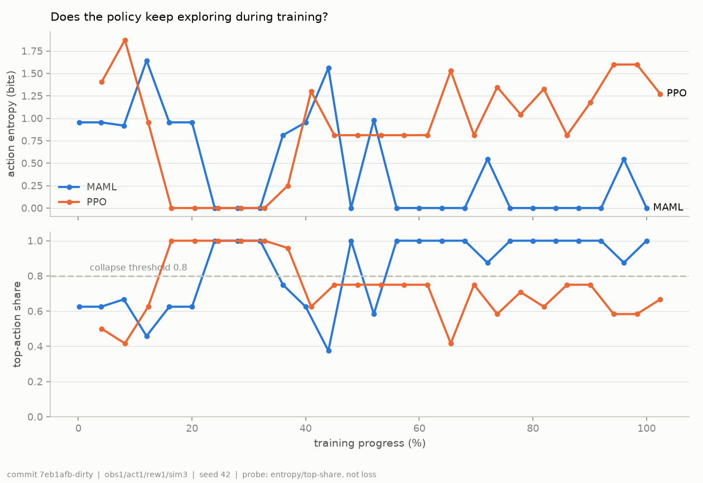

# 고도화 계획서 (ROADMAP) — autonomous-network-mgmt

> 작성일: 2026-09-09
> 선행 문서: `PROJECT_OVERVIEW.md`(구조), `AUDIT_2026-09-09.md`(감사·수정 결과), `FIX_PLAN.md`(2026-09-06 지시서)
> 대상: 이 프로젝트를 "동작하는 연구용 프로토타입"에서 "주장을 뒷받침할 수 있는 시스템"으로 올리기 위한
> 향후 6~12개월 과제. 우선순위는 **현재 결과에서 무엇이 입증되지 않았는가**를 기준으로 정했다.

---

## 0. 출발점 — 지금 무엇이 입증됐고 무엇이 아닌가

두 차례 감사(09-06, 09-09)를 거친 뒤의 정직한 상태다. 고도화는 여기서 출발해야 한다.

| 주장 | 상태 | 근거 |
| --- | --- | --- |
| 폐쇄 루프가 혼잡 링크를 첫 사이클에 식별하고 자동 복구한다 | **입증** (시뮬레이션 내) | stress 50 ep: RCA 100%, 성공 100%, TTR 6.86 (sim_v3; 물리 하한 4틱 + 관측 지연) |
| 복구 성능의 동인은 Analytics(RCA) 계층이다 | **입증** | 절제: analytics_only 7.08 ≈ combined 6.90, 부수 피해 0 vs 0.86 (sim_v3에서도 유지) |
| MAML few-shot 에이전트가 복구에 기여한다 | **반증** — 현재 기여는 음(−) | combined는 TTR 이득 없이 정상 링크만 건드림 |
| PPO/MAML이 상태에 따라 링크를 고르는 정책을 학습했다 | **반증** | MAML은 sim_v3에서도 상수(P8). PPO는 sim_v3에서 붕괴를 벗어났으나 TEST 링크 성공률 0% — §6 참고 |
| 트래픽 공격 탐지기가 실데이터에서 유용하다 | **미입증** | CICDDoS2019 F1 0.56 < 전부-공격 베이스라인 0.72 |
| OSPF 인증·위조 탐지 | 규칙 기반으로 **동작** | 자가 테스트 4종 통과. ML 없음 |
| Java 마이크로서비스 경로(A) | 컴파일만 검증 | Kafka 실기동 미검증 |
| 실제 네트워크(Mininet/OSPF 데몬)에서 동작 | **없음** | `topology.py`는 미사용 참조 구현 |

핵심 진단: **"AI 기반 자율 복구"라는 이름과 달리 지금 일하는 것은 규칙 기반 Analytics다.** RL 계층이
의미를 가지려면 (1) 에이전트가 링크를 특정할 수 있는 관측, (2) 행동 차이가 보상 차이로 이어지는
학습 신호, (3) 규칙이 못 푸는 시나리오가 필요하다. 세 가지 모두 현재 설계에 없다.

---

## 1. 원칙

`FIX_PLAN.md` §0.2를 계승한다. 고도화 과정에서도:

1. 지표가 좋아 보이도록 임계치·하이퍼파라미터를 조정하지 않는다. 조정하면 전/후를 모두 기록한다.
2. 결과 파일은 스크립트 출력으로만 갱신한다. 이전 결과는 `*_pre_<태그>.json`으로 보존한다.
3. 개선이 있어도 기존 한계 서술을 지우지 않는다.
4. **새 기능마다 "이것이 없으면 못 푸는 시나리오"를 먼저 정의한다.** 규칙으로 100% 풀리는 문제에
   학습 모델을 얹는 것은 기여가 아니다 (절제 실험이 이미 보여줬다).
5. 관측·행동·보상 등 계약을 바꿀 때는 버전을 붙인다(`obs_v2`, `action_v2`). 구 체크포인트와 결과는
   구 버전으로 남긴다.
6. 측정 방법을 먼저 고정하고 모델을 바꾼다 (P1의 교훈: 자를 바꾸면 모든 수치가 무효가 된다).

---

## 2. 트랙별 과제

### Track A — RL 계층의 의미 회복 (최우선)

**문제.** 세 정책 전부 상수 행동(P8). 오프라인 평가·절제 실험의 RL 관련 수치는 정책 품질을 재지 못한다.

**원인 분석 (코드 기준).**

| 원인 | 위치 | 설명 |
| --- | --- | --- |
| 관측이 링크를 특정하지 못함 | `network_env.py` 관측 14차원 = 노드 bw×4, lat×4, cost×6 | 링크 스트레스는 인접 노드 평균으로만 보인다. r3-r4 혼잡과 r3·r4 각각의 다른 링크 혼잡을 구분하려면 노드 쌍 패턴을 학습해야 하는데 신호가 약하다 |
| 학습 중 행동이 보상을 바꾸는 스텝이 드묾 | `ANOMALY_PROB = 0.03`, 최대 2개 동시 | 200스텝 에피소드에서 이상은 평균 6회 시작. 나머지 스텝은 어떤 행동이든 보상이 거의 같다 |
| 행동 비용이 없음 | `reward.py` | 정상 링크의 cost를 바꿔도 패널티가 없다. 상수 행동이 손해 보지 않는다 |
| NO-OP 없음 | 행동 30개 전부 cost 변경 | "아무것도 하지 않음"을 표현할 수 없어 정상 상태에서도 교란한다 (P7) |
| MAML 태스크 분포가 사실상 하나 | `train()`이 같은 env로 4 태스크 | 태스크 간 차이가 링크 선택뿐이라 meta-learning의 전제(태스크 분포)가 약하다 |

**과제.**

| ID | 과제 | 구체 변경 | 완료 기준 |
| --- | --- | --- | --- |
| A-1 | 관측 v2: 링크 단위 지표 추가 | 관측에 링크별 이용률(또는 SNMP `ifInOctets` 대응값) 6개 추가 → 20차원. 실제 SNMP는 인터페이스 단위이므로 현실성 훼손이 아니다. `obs_version` 필드로 v1/v2 구분 | `NetworkEnv(obs_version=2)`, `/action` 페이로드에 `linkUtil` 선택 필드, v1 호환 유지 — **환경·폐쇄 루프 완료 2026-11-15** (26차원, §6). `/action` 페이로드는 미착수 |
| A-2 | 행동 v2: NO-OP 추가 | `Discrete(31)`, 인덱스 30 = 무행동. `action_version` 명시. 폐쇄 루프는 이미 "이상 없으면 무행동"이므로 오프라인 경로만 영향 | 오프라인 평가에서 정상 상태 스텝의 cost 변경률 < 5% |
| A-3 | 보상 v2: 행동 비용 + 부수 피해 패널티 | `R -= w_act × 1[cost 변경]`, `R -= w_side × (정상 링크 변경 수)`. 가중치는 **한 번 정하고 고정**, 전/후 기록 | 상수 정책의 보상이 no-op 정책보다 낮아짐을 자가 테스트로 확인 |
| A-4 | 학습 커리큘럼 | 에피소드 시작 시 혼잡 1개 확정 주입 + 확률적 추가 주입, 에피소드 길이 50. "행동이 보상을 바꾸는" 스텝 비율 ≥ 50% | 학습 로그에 anomaly-active 스텝 비율 출력 |
| A-5 | 정책 붕괴 게이트 | `policy_collapse_check.py`를 학습 파이프라인 마지막 단계로 편입. 상수 비율 > 80%면 체크포인트를 "붕괴"로 표시하고 결과 문서에 자동 기록 | 모든 결과 JSON에 `policy_entropy`, `top_action_share` 포함 |
| A-6 | 규칙이 못 푸는 시나리오 도입 | (a) 동시 혼잡 2~3개 (RCA 폴백 규칙이 추정에 그치는 영역), (b) cost 변경이 다른 링크로 혼잡을 옮기는 용량 제약(Track B-2), (c) 노이즈 큰 관측 | 각 시나리오에서 analytics_only 성공률 < 100%가 되어야 RL 기여를 측정할 공간이 생긴다 |
| A-7 | 공정 비교 프로토콜 | PPO·MAML을 같은 obs/action/reward v2, 같은 seed 5개, 같은 스텝 예산으로 학습. 오프라인·폐쇄 루프 각각에서 analytics_only / +PPO / +MAML 절제. 지표: TTR, 성공률, 부수 피해, 상수 비율 | seed 5개 평균±표준편차로 보고. 단일 seed 수치 금지 |

**예상 결과에 대한 솔직한 전망.** A-1~A-4를 해도 단일 혼잡 시나리오에서는 규칙(RCA)이 계속 이길
가능성이 높다. RL의 자리는 A-6의 "규칙이 모호한" 영역이다. 거기서도 이득이 없으면 RL 계층을 제거하고
Analytics 중심 시스템으로 재포지셔닝하는 것이 정직한 결론이며, 그 결론도 기여다.

### Track B — 시뮬레이터 현실성

**문제.** 정답 행동(cost ≥ 100 → 즉시 격리)이 코딩되어 있고, 용량·방향·트래픽 매트릭스가 없다.
분석 계층이 100%인 것은 이 단순함의 결과다.

| ID | 과제 | 구체 변경 | 완료 기준 |
| --- | --- | --- | --- |
| B-1 | 트래픽 매트릭스 + 최단경로 라우팅 | 노드 쌍별 수요 행렬, OSPF cost로 Dijkstra 경로 계산, 링크 부하 = 경로가 지나는 수요의 합. 지금의 "cost 역수 비율" 근사를 대체 | cost 변경이 **다른 링크의 부하를 올리는** 부작용이 재현됨 |
| B-2 | 링크 용량 | 링크별 용량(Mbps), 이용률 = 부하/용량, 스트레스는 이용률의 함수. 우회가 항상 공짜가 아니게 됨 | 우회 경로가 포화되는 시나리오 존재 — **완료 2026-11-14** (§6) |
| B-3 | 다중 동시 이벤트 | 혼잡 2~3개, 혼잡 + 공격, 링크 다운(용량 0) | RCA 폴백 규칙의 정확도를 처음으로 측정 |
| B-4 | 관측 지연·손실 | SNMP 폴링 주기 모사(관측이 n틱 지연), 관측 누락 확률 | 503 처리 경로(A4)가 실제로 쓰임 |
| B-5 | 시뮬레이터 자가 테스트 확장 | 시정수, 용량 포화, 라우팅 정합성 등을 `metric_generator.py __main__`에 추가 | 자가 테스트가 회귀를 잡음 |
| B-6 | Mininet + FRR(OSPF 데몬) 실연동 | `topology.py`를 OVS 스위치가 아닌 FRR 라우터 컨테이너로 재작성. `MininetClient.setOspfCost`가 실제 `vtysh` 명령으로 cost 변경. 메트릭은 실제 인터페이스 카운터 | 실제 OSPF 재수렴 시간이 TTR에 포함됨. Linux 전용, Docker `privileged` |

B-1~B-3은 Python만으로 가능하고 Track A의 전제다. B-6은 별도 마일스톤(Phase 3).

### Track C — 트래픽 공격 탐지기의 실데이터 유효성

**문제.** F1 0.56 < 베이스라인 0.72. 원인은 피처(문서화됨)와 모델 구조(P4) 둘 다.

| ID | 과제 | 구체 변경 | 완료 기준 |
| --- | --- | --- | --- |
| C-1 | `Flow Duration == 0` 플로우 처리 | 제외 대신 "패킷 수 / 최소 시간 단위"로 전송률 추정하거나 별도 피처(`zero_duration_flow_count`)로 분리 | 제외 플로우 0건, 결과 전/후 병기 |
| C-2 | 대체 피처 | `syn_ratio`(죽은 피처) 대신 단방향 플로우 비율(`bwd_packets == 0`), 플로우 수/초, 평균 플로우 길이. `update()/detect()` 6인자 시그니처는 v1으로 유지하고 v2 API 추가 | 피처별 단변량 AUC 보고 |
| C-3 | 지도학습 베이스라인 | 로지스틱 회귀·GBM을 같은 윈도우 피처로 학습(시간 순 분할: 앞 70% 학습, 뒤 30% 평가). 비지도 IF가 이 베이스라인과 얼마나 차이 나는지 보고 | 결과 표에 IF / LR / GBM / 전부-공격 4행 |
| C-4 | 온라인 학습 게이팅 | `is_threat=True`로 판정한 샘플은 학습 버퍼에 넣지 않음(자기 강화 방지). contamination은 데이터의 추정 base rate로 설정하되 **전/후 기록** | 지속 공격 200윈도우 후에도 탐지율 유지 (시뮬레이션으로 검증) |
| C-5 | 데이터셋 확장 | CICDDoS2019 다른 공격일 CSV, CIC-IDS2017(포트스캔 포함) — 포트스캔 분기의 첫 실검증 | 공격 유형별 혼동 행렬 |
| C-6 | 재현 자동화 | 데이터 준비 스크립트 + 결과 파일 스키마 버전(`schema_version`) | `python validate_security_detector.py --all` 한 번으로 전 표 재생성 |

### Track D — 운영 파이프라인

| ID | 과제 | 구체 변경 | 완료 기준 |
| --- | --- | --- | --- |
| D-1 | Java 경로 실기동 검증 | Docker Compose로 Kafka + 시뮬레이터(`SIM_CLOCK=realtime:1000`) + collector + orchestrator + AI 엔진 기동, 혼잡 주입 → cost 변경까지 E2E | compose 프로파일 `e2e`, 검증 스크립트가 30초 내 cost 변경 확인 |
| D-2 | 제어 경로 단일화 | (A) Java 경로가 `/action`(단건) 대신 `/auto-step`을 호출하거나, (B) `/auto-step`의 Orient·Decide 로직을 라이브러리로 분리해 두 경로가 공유. 현재는 같은 목적의 루프가 두 벌(§3.2 OVERVIEW) | 절제 실험 결과가 두 경로에서 같음 |
| D-3 | 메트릭·결정 이력 저장 | PostgreSQL 재도입(이번엔 코드와 함께): 관측, 진단, 행동, 결과를 시계열로 저장. 대시보드 라이브화의 전제 | `/history?from=&to=` API |
| D-4 | 대시보드 라이브화 | 정적 데모 대신 `/live-results`·`/history`를 읽는 프런트. 정적 버전은 GitHub Pages용으로 유지 | 라이브/정적 빌드 분리 |

> 도판·대시보드 작업의 상세 계획은 `cowork/VISUALIZATION_PLAN.md`에 있다. 특히 현재 대시보드가
> 철회된 수치(TTR 3.78, 랜덤 정책 베이스라인, 샘플 효율 곡선)를 렌더링하고 있다는 점을 다룬다.
| D-5 | 관측성 | 구조화 로그(JSON), 사이클별 지연·실패 카운터, `/metrics`(Prometheus) | 503·apply 실패가 카운터로 보임 |
| D-6 | 접근 제어 | `/debug/*`·`/reset-buffer`에 토큰, CORS 화이트리스트, OSPF 키를 환경변수/키스토어로 | README 보안 범위 절 갱신 |

### Track E — 품질 인프라

| ID | 과제 | 구체 변경 | 완료 기준 |
| --- | --- | --- | --- |
| E-1 | 자가 테스트 러너 | `scripts/selftest.sh`: `metric_generator`, `anomaly_detector`, `topology`, `ospf_security`, `cicddos_loader` `__main__` 순차 실행 + `policy_collapse_check` + `mvn -q compile`. pytest 도입은 owner 결정 사항 | 한 명령으로 전부 통과/실패 |
| E-2 | CI | GitHub Actions: E-1 + FastAPI TestClient로 `/auto-step` 503 경로·정상 경로 스모크. 학습·실험은 CI 밖 | PR마다 실행 |
| E-3 | 재현 파이프라인 | `experiments/reproduce.sh`: MAML/PPO 학습(seed 목록) → 오프라인 평가 → 서버 기동 → 폐쇄 루프 3종 → 결과 요약 표 생성. 이번 세션의 임시 `pipeline.sh`를 정식화 | README의 모든 수치가 이 스크립트 출력과 일치 |
| E-4 | 결과 파일 규약 | 모든 결과 JSON에 `schema_version`, `_condition`, `seed`, `git_commit`, `obs/action/reward_version` | 결과 파일만 보고 측정 조건을 알 수 있음 |
| E-5 | 체크포인트 관리 | 체크포인트 파일명에 버전·날짜·커밋(`maml_v2_20261001_abc123.pt`), `agents/MANIFEST.md`에 학습 조건 기록. 운영 체크포인트 심볼릭 이름은 매니페스트로 해석 | 체크포인트-결과-커밋 추적 가능 |

### Track F — 연구 포지셔닝

현재 데이터로 정직하게 주장할 수 있는 것과 없는 것을 분리한다.

| 주장 가능 (지금) | 주장하려면 필요한 것 |
| --- | --- |
| ETSI ZSM 폐쇄 루프(Observe–Orient–Decide–Act–Evaluate)의 참조 구현과 절제 실험 방법론 | — |
| 인접도 기반 RCA가 단일 혼잡을 첫 사이클에 100% 식별 (시뮬레이션) | 다중 혼잡·용량 제약(B-1~B-3)에서의 정확도 |
| "RL 계층의 기여를 절제 실험으로 분리해 음(−)임을 확인" — 부정적 결과 자체가 기여 | — |
| OSPF 인증 우회 시나리오 3종의 규칙 기반 탐지 | ML 시퀀스 모델과의 비교 |
| 측정 방법론 결함(관측 주도 시간, 첫 사이클만 재는 RCA 정확도)의 발견과 수정 | — |
| MAML few-shot 적응의 이점 | Track A 전부 + A-6 시나리오에서 유의한 이득 |
| 실데이터 DDoS 탐지 | Track C-1~C-4에서 베이스라인 초과 |

---

## 3. 단계별 로드맵

### Phase 1 (1~2개월) — 자를 고정하고 학습 문제를 풀 수 있게 만든다

- E-1, E-3, E-4 (측정·재현 인프라 먼저)
- B-1, B-2, B-3 (시뮬레이터에 트래픽 매트릭스·용량·다중 이벤트)
- A-1, A-2, A-3, A-4, A-5 (관측/행동/보상 v2, 커리큘럼, 붕괴 게이트)
- C-1, C-4 (탐지기의 가장 큰 누수와 자기 강화 차단)

**완료 기준**: `reproduce.sh` 한 번으로 모든 표가 재생성되고, 학습된 정책의 상수 비율이 80% 아래로
내려가며, 다중 혼잡 시나리오에서 analytics_only 성공률이 100% 미만인(=RL이 기여할 공간이 있는)
벤치마크가 존재한다.

### Phase 2 (3~4개월) — 기여를 측정한다

- A-6, A-7 (규칙이 모호한 시나리오에서 seed 5개 공정 비교)
- C-2, C-3, C-5 (피처 재설계, 지도학습 베이스라인, 포트스캔 실검증)
- D-1, D-2 (Java 경로 E2E, 제어 경로 단일화)
- E-2 (CI)

**완료 기준**: RL 계층의 기여가 유의하게 양(+)이거나, 아니면 RL 계층 제거 결정. 탐지기가
전부-공격 베이스라인을 넘거나, 아니면 "비지도 IF는 이 문제에 부적합"을 지도학습 대비로 결론.
어느 쪽이든 문서에 기록.

### Phase 3 (5~6개월+) — 실제 네트워크

- B-6 (Mininet + FRR OSPF 실연동), B-4 (관측 지연)
- D-3, D-4, D-5, D-6 (이력 저장, 라이브 대시보드, 관측성, 접근 제어)
- 실제 SDN 컨트롤러 연동으로 OpenFlow 차단 룰 실제 적용 (현재는 반환만)

**완료 기준**: 실제 OSPF 재수렴을 포함한 TTR(초 단위)이 측정되고, 시뮬레이션 TTR과의 관계가 문서화됨.

---

## 4. 리스크와 대응

| 리스크 | 대응 |
| --- | --- |
| Track A를 다 해도 RL이 규칙을 못 이김 | 그것이 결론이면 그대로 발표. Analytics 중심으로 재포지셔닝(Track F). 시간 상한: Phase 2 종료 |
| 관측/행동/보상 v2가 이전 결과를 전부 무효화 | 버전 태그로 공존. v1 결과는 `*_v1` 로 보존하고 README에 병기 |
| 시뮬레이터가 복잡해지며 "정답이 코딩된" 문제가 다른 형태로 재발 | 새 시뮬레이터마다 "규칙 기반 최적 정책"을 먼저 구현하고 그 성능을 상한선으로 보고 |
| 실데이터 확장 시 데이터 접근 제약(UNB 가입, 용량) | 준비 스크립트 + 체크섬으로 재현성 확보, 데이터 자체는 커밋 금지 |
| Mininet/FRR은 Linux 전용, 개발 환경(Windows)과 불일치 | Docker `privileged` 컨테이너로 격리, CI는 시뮬레이션만 |
| 하나의 실험 세션이 길어 재현이 부담 | `reproduce.sh`에 `--quick`(seed 1, 10 ep) 모드 |

---

## 5. 당장 시작할 수 있는 것 (의존성 없음, 각 반나절 이내)

1. **E-1 자가 테스트 러너** — 이미 있는 `__main__` 테스트 5개 + 붕괴 검사 + `mvn compile`을 스크립트 하나로.
2. **E-4 결과 파일 규약** — 실험 스크립트 3종 + `run_experiment.py`에 `git_commit`·`schema_version` 필드 추가.
3. **A-5 붕괴 게이트** — `few_shot_agent.py --train` 끝에 `policy_collapse_check` 호출, 결과를 학습 로그와 체크포인트 옆 `*.meta.json`에 기록.
4. **B-1 트래픽 매트릭스** — `metric_generator._compute_link_traffic()`를 Dijkstra 기반으로 교체. 자가 테스트에 "cost를 올리면 우회 경로 부하가 오른다" 추가.
5. **C-1 zero-duration 플로우** — `cicddos_loader._compute_pkt_rate()`에 처리 모드 추가, 결과 전/후 병기.

이 다섯 개가 끝나면 Phase 1의 나머지(관측/행동/보상 v2)를 같은 자로 잴 수 있다.

---

## 6. 진행 기록

### 2026-09-09 — §5의 다섯 과제 완료 + E-3

| ID | 산출물 | 상태 |
| --- | --- | --- |
| E-1 | `scripts/selftest.sh` | 완료 — 모듈 자가 테스트 6종 + compileall + 붕괴 검사 + `mvn compile` |
| E-3 | `experiments/reproduce.sh` | 완료 — 학습 → 오프라인 평가 → 폐쇄 루프 3종 → 요약 |
| E-4 | `experiments/_resultmeta.py` | 완료 — 모든 결과 JSON에 `schema_version`/`git_commit`/`seed`/계약 버전 |
| A-5 | `ai-engine/policy_check.py` | 완료 — 학습 직후 자동 검사, `<체크포인트>.meta.json` |
| C-1 | `cicddos_loader` zero-duration 모드 | 코드 완료, **실데이터 미측정** (CSV 부재) |
| B-1 | 수요 행렬 + 최단경로(ECMP) 라우팅 | 완료 — `SIM_VERSION = 3` |

> **2026-09-13 갱신**: 시뮬레이터 난수까지 시드하도록 고친 뒤(아래 5번) 재측정한 값은
> stress 6.88 / 절제 7.08·13.86·7.00 / 오프라인 PPO 200.0·MAML 101.93이다. 결론은 같고
> 이제 **재현 가능하다**. 도판은 `experiments/figures/out/`.

**측정 결과 (sim_v2 → sim_v3, 50 ep, seed 42, TEST 링크 held-out)**

| 실험 | sim_v2 | sim_v3 |
| --- | --- | --- |
| stress | TTR 6.84, 부수피해 0.80/ep | **6.86** (TEST 6.75 / TRAIN 7.06), 0.80/ep |
| 절제 analytics_only | 6.94 / 100% / 0.00 | **7.08 / 100% / 0.00** |
| 절제 maml_only | 13.80 / 14% | **13.86 / 14%** |
| 절제 combined | 6.94 / 100% / 0.86 | **6.90 / 100% / 0.86** |
| 지속 버퍼 | 6.93 (초기 7.00 → 후기 6.87) | **7.10 (7.27 → 6.93)** |
| 오프라인 PPO | 101.8 / 50% | **200.0 / 0%** |
| 오프라인 MAML | 101.8 / 50% | **101.81 / 50%** |

### 이번에 새로 확인된 것

1. **우회에 대가를 만들어도 폐쇄 루프 수치는 그대로다.** TTR을 결정하는 것은 혼잡 링크 격리와
   감쇠 대기이고, 우회 부하가 이웃 링크에 주는 부담은 TTR을 움직일 만큼 크지 않다.
   절제 결론(복구는 Analytics가 한다)이 "우회가 공짜가 아닌" 시뮬레이터에서도 유지된다.

2. **PPO의 정책 붕괴는 B-1로 풀렸다 — 그러나 문제는 안 풀렸다.** sim_v3 PPO는 서로 다른 행동
   6개, 최빈 비율 0.65, 엔트로피 1.70 bit로 붕괴 판정을 통과한다(sim_v2에서는 비율 1.00).
   그런데 오프라인 성공률은 50% → **0%** 로 떨어진다. 그 행동들 중에 TEST 링크가 필요로 하는
   것이 없기 때문이다. **"붕괴하지 않은 정책"과 "푸는 정책"은 다르다** — P8의 해결 기준을
   상수 비율만으로 잡으면 안 된다는 뜻이고, A-1(관측이 링크를 특정)이 여전히 핵심이다.

3. **MAML은 sim_v3에서도 완전 붕괴다** (비율 1.00, 엔트로피 0, `r3-r4@100`). 오프라인 성공률
   50%는 TEST 링크 둘 중 `r3-r4`가 그 상수와 우연히 일치하는 비율일 뿐이다.

4. **학습/평가 링크 누수 (신규 결함, 수정 완료).** `reproduce.sh`가 에이전트 스크립트를 직접
   호출해 `train_links=None`이 되면서 TEST 링크까지 학습에 들어갔다. 누수 상태에서는 PPO·MAML이
   둘 다 ~101.8로 **동등해 보였고**, 링크를 실제로 분리하자 200.0 vs 101.81로 갈렸다.
   A-5가 남긴 `train_links: null` 기록이 이 결함을 드러냈다 — 측정 인프라가 곧바로 값을 했다.
   AUDIT §3.5의 오프라인 수치(2026-09-09 감사분)도 같은 방식으로 학습된 체크포인트를 잰 것이라
   링크 분리가 보장되지 않는다.

### 5. 학습 동역학 — T1이 답한 것 (2026-09-13)

학습 중 정책 행동을 기록하기 시작하자(VISUALIZATION_PLAN T1) 끝점만 보던 때는 보이지 않던
것이 나왔다. **두 정책의 차이는 붕괴 여부가 아니라 회복 능력이다.**

| | 최초 붕괴 | 이후 | 최종 |
| --- | --- | --- | --- |
| **MAML** | iter 120 / 500 (**24%**) | 붕괴·회복을 오가다 iter 260 이후 갇힘 | 엔트로피 0.00, 상수 `r3-r4@100` |
| **PPO** | 8,192 / 50,000 스텝 (**16%**) | 20,480스텝부터 회복해 유지 | 엔트로피 1.27~1.65, 붕괴 아님 |

두 가지를 시사한다.

1. **MAML 학습의 뒤쪽 절반(약 240 iteration)은 이미 죽은 정책 위에서 돈다.** 학습량을 늘리는
   것으로는 해결되지 않는다는 뜻이다.
2. 탐색이 아예 없는 게 아니라 **붕괴 상태에서 빠져나올 유인이 없다.** 상수 행동이 보상 면에서
   손해를 보지 않기 때문이다 — A-4(커리큘럼)보다 **A-3(보상: 행동 비용·부수 피해 패널티)를
   먼저 볼 근거**다.

그리고 **"붕괴하지 않음"은 "푼다"가 아니다.** sim_v3 PPO는 붕괴를 벗어났지만(1.65 bit,
서로 다른 행동 6종) TEST 링크 성공률은 여전히 0%다. A-1(관측이 링크를 특정)이 빠진 한
탐색이 늘어도 갈 곳이 없다.

### 6. 이번에 발견된 결함 — 학습 재현성 (2026-09-13, 수정 완료)

T1의 "프로브가 학습을 방해하지 않는다"를 검증하다가 **기존 결함**을 찾았다. `train()`이
torch·numpy·random은 시드하면서 `metric_generator`의 자체 난수 스트림은 시드하지 않아,
**같은 프로세스에서 같은 seed로 두 번 학습하면 결과가 달랐다.** `run_experiment.py`는 MAML과
PPO를 한 프로세스에서 학습하므로 실제로 영향을 받던 자리다.

`NetworkEnv(sim_seed=)`로 고쳤고, 같은 seed → 동일 체크포인트(해시 일치)임을 확인했다.
프로브도 `metric_generator.snapshot()/restore()`(난수 상태 포함)로 감싸 비침습적임을 확인했다.
2026-09-13 이전 결과는 시뮬레이터 노이즈를 OS 엔트로피에서 뽑았으므로 정확히 재현되지 않는다.

### 2026-11-14 — 연구 질문 확정, B-2(링크 용량) 완료, 규칙이 깨지는 구간 최초 확인

**연구 질문 (학위논문 범위).** ZSM 폐쇄 루프에서 규칙 기반 Analytics가 근본 원인을 특정하지
못하거나 정해진 조치가 통하지 않는 조건일 때, 학습 기반 Intelligence 계층이 복구에 기여하는가?

| 가설 | 내용 | 상태 |
| --- | --- | --- |
| H1 | 단일 혼잡·용량 제약 없음 → 규칙만으로 충분 | 지지 (절제 실험, 기존) |
| H2 | 용량 제약·다중 혼잡 → 풀이가 있는데도 규칙 단독이 실패하는 시나리오가 존재 | **지지 (아래)** |
| H3 | 그 구간에서 "규칙 + 학습"이 "규칙 단독"보다 유의하게 낫다 | 미검증 — A-1~A-4 이후 |

OSPF 인증·DDoS 탐지(Track C)는 이 질문의 범위 밖이다. 코드와 기록은 남기되 더 넓히지 않는다.

**B-2 산출물.** `metric_generator.set_capacity_mode("finite")` / `SIM_CAPACITY=finite`. 기본값
(`unlimited`)은 sim_version 3와 비트 단위로 같다 — 절제 실험 50 ep × 3모드를 다시 돌려 에피소드별
TTR이 커밋된 결과와 전부 일치함을 확인했다. finite 모드에서 달라지는 것은 둘이다: (1) 이용률이 1을
넘으면 과부하 스트레스가 붙는다, (2) 혼잡 링크의 격리 기준이 cost 임계값(≥100)이 아니라 **실제로
실린 부하가 0인가**다. `predict_steady_state()`로 cost 배치 15,625개를 전수 대입해 시나리오마다
풀이의 존재 여부를 먼저 가린다(§4 "규칙 기반 최적 정책을 상한선으로"의 첫 구현).

**측정 (`experiments/capacity_probe.py`, `results/capacity_probe.json`, 커밋 `8e3d8cd`).**
혼잡 조합(단일 6 + 이중 15) × 용량 프로파일(균일 2.0 / 링크 하나만 1.2인 6종) = 147 시나리오,
시나리오당 5 seed, Analytics 단독(`/auto-step?disable_maml=true`), 15 사이클 타임아웃 뒤 10 사이클
동안 재발 여부 확인.

| 구간 | 시나리오 | 풀이 존재 | 규칙 성공 | 규칙 실패 | 풀이 없음 |
| --- | --- | --- | --- | --- | --- |
| 단일 혼잡 · 균일 용량 | 6 | 6 | **6** | 0 | 0 |
| 단일 혼잡 · 약한 링크 | 36 | 36 | 12 | **24** | 0 |
| 이중 혼잡 · 균일 용량 | 15 | 3 | 0 | **3** | 12 |
| 이중 혼잡 · 약한 링크 | 90 | 6 | 0 | **6** | 84 |
| 합계 | 147 | 51 | 18 | **33** | 96 |

풀이가 있는 51개 중 규칙이 푸는 것은 18개(35%)다. 시나리오 안에서 seed에 따라 결과가 갈린 경우는
없다(전부 5/5 또는 0/5). 오라클이 제시한 풀이 51개는 노이즈가 있는 시뮬레이터에 직접 대입해
전부 SLA를 유지함을 따로 확인했다.

**규칙이 깨지는 방식은 두 가지다.**

1. **조치가 틀린다 (단일 혼잡 · 약한 링크 24건).** RCA는 혼잡 링크를 맞게 짚는다. 그러나
   "cost 100"으로 격리하면 우회 트래픽(부하 1.5)이 용량 1.2인 링크에 실려 그 링크가 포화하고,
   규칙은 포화한 정상 링크를 다시 근본 원인으로 짚어 격리한다 — 연쇄다. 풀이는 최소 4개 링크의
   cost를 함께 바꿔 우회를 약한 링크 밖으로 돌리는 것이다(예: 혼잡 `r1-r3`, 약한 `r1-r2` →
   `r1-r3@50, r1-r2@20, r2-r3@20, r2-r4@20`). 약한 링크가 혼잡 링크 자신이거나 우회 경로에
   없는 12건은 규칙이 그대로 푼다.
2. **진단이 틀린다 (서로 떨어진 이중 혼잡 9건).** 네 노드가 전부 위반이라 모든 링크가 "위반 노드
   둘에 인접"하다. RCA 폴백은 알파벳순으로 고르고, 결국 6개 링크를 전부 cost 100으로 올린다.
   풀이는 혼잡한 두 링크만 올리는 것(2개 변경)이다.

**이 결과가 말하지 않는 것.**

- **"규칙이 못 푼다"는 "학습이 필요하다"가 아니다.** 깨진 것은 *지금의* 규칙이다. 1번은 "격리
  전에 우회 이용률을 계산한다"는 규칙으로, 2번은 링크 단위 관측만 있으면 규칙으로 풀릴 수 있다.
  H3를 재려면 그 강화된 규칙을 먼저 만들어 기준선으로 삼아야 한다 — 약한 규칙을 이기는 것은
  기여가 아니다.
- **2번은 현재 관측(노드 평균 14차원)으로는 누구도 풀 수 없을 가능성이 높다.** 서로 떨어진
  링크 쌍 3가지가 노드 지표로는 구분되지 않는다. A-1(링크 단위 관측)이 규칙과 학습 양쪽의 전제다.
- 풀이 없는 96건은 벤치마크에서 뺀다. 한 노드의 링크 둘이 혼잡하면 그 노드로 가는 수요 3이
  남은 링크 하나(용량 2.0)를 넘는다 — 정책의 실패가 아니라 시나리오의 성질이다.
- K4 · 균일 수요 · 용량 상수 2.0/1.2 한 벌에서의 결과다. 상수는 실험 전에 정했고 결과를 보고
  바꾸지 않았다. 더 큰 토폴로지에서 같은 구간이 나오는지는 미확인.
- `SIM_VERSION`은 3 그대로이고 용량 모드는 결과 파일의 `sim_capacity_mode`로 구분한다. 기존
  실험 스크립트(stress/ablation/persistent)는 이 필드를 적지 않으므로 finite 모드로 돌리면 안 된다.

**부수 발견 — 결과 파일의 `-dirty` 표시가 무의미했다 (수정 완료).** 실험 스크립트가 결과 파일을
쓰려고 연 뒤에 커밋 해시를 읽어서, 코드가 커밋과 같아도 항상 `-dirty`가 찍혔다. 2026-11-14 이전
결과 파일이 전부 `-dirty`인 이유이며, 그 파일들의 dirty 표시로는 측정 코드가 커밋과 같았는지
알 수 없다. `_resultmeta.git_commit()`이 `experiments/results/` 아래의 변경을 세지 않도록 고쳤고
자가 테스트를 붙였다. 위 측정은 수정 후 다시 돌린 것이라 해시에 `-dirty`가 없다. 세 번 돌린
결과(시나리오별 에피소드 전부)는 서로 같았다.

**다음.**

1. **A-1 관측 v2** (링크별 이용률) — 위 두 실패 모두의 전제
2. **강화된 규칙 기준선** — 이용률을 보고 조치를 고르는 규칙. 이것까지 깨지는 시나리오가 H3의 무대
3. A-2 NO-OP, A-3 보상 v2 → 재학습 → A-7 공정 비교 (seed 5개)
4. B-3 잔여(링크 다운), 더 큰 토폴로지, `reproduce.sh`에 capacity_probe 편입

### 2026-11-15 — A-1(링크 단위 관측) 완료, 기준선 사다리 v1 → v2 → v3

2026-11-14의 "다음" 1·2번을 했다. 같은 51개 시나리오(풀이 존재), 같은 seed, 시나리오당 5 에피소드.

**A-1 산출물.** 시뮬레이터가 링크(인터페이스)별 이용률·손실·용량을 낸다(`GET /metrics/links`,
SNMP 인터페이스 테이블 대응). 계획서는 "이용률 6개"였지만 **이용률만으로는 고장 링크를 찾지
못한다** — 혼잡 링크의 이용률은 정상 링크와 같다 — 그래서 링크 손실을 함께 넣었다.
`NetworkEnv(obs_version=2)`는 14 + 12 = 26차원이다. 기본값(v1)은 링크 관측을 읽지 않으므로
이전 결과와 같다(절제 실험 재실행으로 에피소드별 일치 확인).

**세 가지 Analytics.**

| | 진단 | 조치 | 아는 것 |
| --- | --- | --- | --- |
| v1 (기존) | 노드 지표에서 링크를 추정 | 근본 원인 링크 cost 100 | 토폴로지 |
| v2 | 링크를 직접 본다: fault / overload / draining 분류 | fault 링크만 cost 100 | + 링크 이용률·손실 |
| v3 | v2와 같음 | cost 배치 15,625개를 라우팅 모델로 전수 탐색 — 고장 링크 부하 0, 전 링크 이용률 ≤ 1, 최소 변경 | + 라우팅 모델, 용량, 수요 추정 |

**측정 (`results/capacity_probe.json` / `_v2.json` / `_v3.json`).**

| | 시나리오 완전 해결 | 부분 | 실패 | 에피소드 안정 복구 | 평균 TTR (복구분) | 고장 아닌 링크 변경/ep |
| --- | --- | --- | --- | --- | --- | --- |
| v1 | 18 / 51 | 0 | 33 | 90 / 255 | 7.23 | 2.05 |
| v2 | 26 / 51 | 1 | 24 | 134 / 255 | 8.54 | 0.00 |
| v3 | 49 / 51 | 2 | 0 | 253 / 255 | 9.54 | 1.41 |

| 구간 (시나리오 수) | v1 | v2 | v3 |
| --- | --- | --- | --- |
| 단일 혼잡 · 균일 용량 (6) | 30/30 | 30/30 | 30/30 |
| 단일 혼잡 · 약한 링크가 우회 밖 (12) | 60/60 | 60/60 | 60/60 |
| 단일 혼잡 · 약한 링크가 우회 경로 (24) | 0/120 | 0/120 | 119/120 |
| 서로 떨어진 이중 혼잡 (9) | 0/45 | 44/45 | 44/45 |

**읽는 법.**

1. **진단 실패는 관측의 문제였다.** v2는 이중 혼잡 9건을 전부 맞게 조치한다 — 규칙을 똑똑하게
   만든 게 아니라 링크를 보게 했을 뿐이다. 정상 링크를 건드리는 일도 사라졌다(2.05 → 0.00/ep).
2. **조치 실패는 규칙으로 안 풀린다.** 약한 링크가 우회 경로에 있는 24건에서 v2는 고장 링크를
   격리한 뒤 포화한 링크를 보고도 할 수 있는 게 없다(연쇄 격리는 하지 않는다). 풀이는 4개 링크를
   함께 바꾸는 것이고, 그것을 찾는 일은 탐색이다.
3. **모델이 맞으면 탐색이 전부 푼다.** v3는 255 에피소드를 전부 복구한다. v3에서 "고장 아닌 링크
   변경" 1.41/ep는 낭비가 아니라 우회를 돌리는 조치다.
4. 안정 판정에서 빠진 3 에피소드(v2 1건, v3 2건)는 **조치가 전부 옳았다.** 우회 링크 이용률이
   정확히 1.0인 배치에서 회복 막바지에 노드 손실이 SLA(1 %)를 한 사이클 넘은 것이다(관측 노이즈
   약 2.4σ). 판정 기준(추가 10 사이클의 마지막 사이클)은 측정 전에 정한 것이라 바꾸지 않았다.
5. v1과 v2의 단일·균일 TTR 차이(6.77 vs 7.20)는 정책 차이가 아니다. v2는 링크 관측을 읽으면서
   시뮬레이터 난수를 소비해 같은 seed라도 노이즈 수열이 달라진다.

**연구 질문에 주는 함의 — 방향 결정이 필요하다.**

- v3는 **시뮬레이터와 같은 라우팅 모델을 가진다**(자가 테스트가 일치를 확인한다). 그래서 v3는
  학습이 넘어야 할 기준선이 아니라 상한선이다. 완벽한 모델이 있는 한 학습 계층이 설 자리는 없다.
- 학습이 의미를 가지려면 **모델이 틀리는 조건**이 있어야 한다: 수요가 알려지지 않았거나 바뀌는
  경우(v3는 cost가 균일할 때만 수요를 읽을 수 있다), 용량 보고가 실제와 다른 경우, 토폴로지가
  커서 전수 탐색이 안 되는 경우(K4는 15,625개지만 링크 20개면 5^20).
- 따라서 H3는 다음처럼 구체화된다: **"모델 없는 규칙(v2)보다 낫고, 모델이 틀린 계획기(v3)보다
  나은 학습 정책이 있는가."** 비교 대상이 둘로 정해졌고, 둘 다 구현되어 있다.

**이 결과가 말하지 않는 것.**

- 여전히 K4 · 균일 수요 · 용량 상수 한 벌이다.
- v3의 수요 추정은 이 벤치마크에서 항상 정확하다(에피소드가 균일 cost에서 시작한다). 모델이
  틀릴 때 v3가 얼마나 나빠지는지는 재지 않았다 — 그것이 다음 측정이다.
- 학습 정책은 아직 하나도 돌리지 않았다.

**다음.**

1. **모델 불일치 시나리오** — 에피소드 도중 수요가 바뀌거나 비균일한 경우를 넣고 v3의 저하를 잰다.
   v3가 여전히 전부 풀면 이 토폴로지에서는 학습의 자리가 없다는 결론이 된다
2. A-2 NO-OP, A-3 보상 v2 → 관측 v2로 PPO·MAML 재학습 (용량 모드, 풀이 있는 시나리오 분포)
3. A-7 공정 비교: v2 / v3 / 학습 정책, seed 5개

### 2026-11-16 — 모델 불일치(수요 변화) 측정: 이 토폴로지에는 학습이 설 자리가 거의 없다

2026-11-15의 "다음" 1번. 계획기(v3)가 전부 푼 것은 **정확한 수요**를 가졌기 때문이었다 —
에피소드가 균일 cost에서 시작해 첫 사이클에 수요가 그대로 읽힌다. 그 가정을 깼다.

**설계 (`experiments/demand_shift_probe.py`).** 풀이 있는 기반 시나리오 51개 × 수요가 오르는 쌍
6개 = 306개 중, 변화 **뒤**에도 풀이가 있는 150개(전부 단일 혼잡 — 이중 혼잡은 수요가 오르면
풀이가 사라진다). 3번째 사이클 직후 한 쌍의 수요가 1.0 → 2.0이 된다. 이 시점에는 cost가 이미
균일하지 않아 링크 부하에서 수요를 유일하게 읽을 수 없다. 시나리오당 3 seed, 30 사이클 고정,
`stable` = 마지막 5 사이클 중 4번 이상 SLA 충족(측정 전에 고정).

**비교 대상.** v2(링크 관측 규칙, 모델 없음), v3(계획기, 수요 추정 고정), **v4(신규)** — 관측 부하가
모델 예측과 0.05 넘게 어긋나면 수요를 다시 추정하는 계획기. 재추정은 "관측 부하를 설명하는 수요
중 이전 추정에 가장 가까운 것"(의사역행렬)이며 정확한 복원이 아니다.

**측정 (`results/demand_shift_v2.json` / `_v3.json` / `_v4.json`, 450 에피소드씩).**

| 구간 (시나리오 / 에피소드) | v2 규칙 | v3 고정 계획기 | v4 적응형 계획기 |
| --- | --- | --- | --- |
| 수요 변화가 원래 계획을 깬다 (72 / 216) | 0 | 0 | **203** |
| 원래 계획이 유지된다 · 기반이 규칙으로 풀림 (30 / 90) | 89 | 89 | 89 |
| 원래 계획이 유지된다 · 기반에 계획기 필요 (48 / 144) | 0 | 140 | 140 |
| **합계 (150 / 450)** | **89** | **229** | **432** |

**읽는 법.**

1. **낡은 모델은 모델이 없는 것과 같다.** 수요 변화가 계획을 깨는 216 에피소드에서 v3는 v2와
   똑같이 0이다. v3는 자기 모델로는 현재 배치가 만족스럽다고 판단해 아무것도 하지 않는다.
2. **모델을 고치면 거의 다 회복된다.** v4는 그 216 중 203(94 %)을 푼다. 수요 변화 뒤 평균 3.05개의
   조치를 더 하고, 변화 시점부터 평균 12 사이클에 정착한다.
3. **v4와 오라클의 차이는 18 에피소드(4 %)다.** 그중 5건은 v3·v4가 같은 seed에서 같이 놓친 것으로,
   조치는 옳고 SLA 경계에 걸친 배치에서 노이즈로 판정이 갈렸다. **수요 추정 오류로 실제로 틀린
   배치에 도달한 것은 13 에피소드(2.9 %), 시나리오로는 3개 전부 실패 + 2개 부분 실패**다.
   이 경우 v4는 재추정한 수요로 "풀이를 찾았다"고 믿고 약한 링크의 cost를 한 번 더 바꾼 뒤 멈춘다.

**결론 — H3에 대해.**

- 이 벤치마크(K4, 링크 부하를 노이즈 없이 관측)에서 학습 정책이 v4보다 나아질 수 있는 여지는
  **최대 18 / 450 에피소드**다. 학습 정책이 그 전부를 푼다 해도 4 %포인트이고, 그중 절반 가까이는
  노이즈 경계다. **이 토폴로지에서는 H3를 의미 있게 검증할 수 없다.** 재학습에 시간을 쓰기 전에
  알아야 했던 것이 이것이다.
- 계획기가 강한 이유는 두 가지이고, 둘 다 이 환경의 성질이다: (1) cost 배치가 15,625개뿐이라
  **전수 탐색이 된다**, (2) 링크 부하가 **정확히 관측된다**(이용률에 노이즈가 없다).
- 따라서 학습이 설 자리를 만들려면 둘 중 하나를 깨야 한다:
  - **규모** — 링크 20개면 배치가 5^20 ≈ 10^14개라 전수 탐색이 불가능하다. 계획기는 휴리스틱
    탐색으로 물러나야 하고, 그 탐색의 품질과 학습 정책을 비교하게 된다.
  - **관측** — 이용률에 측정 노이즈·지연·누락을 넣으면 재추정이 흔들린다. 다만 K4에서는
    전수 탐색이 남아 있어 계획기가 여전히 유리할 가능성이 높다.
- 반대로, 여기까지의 결과만으로도 주장할 수 있는 것이 있다: **"ZSM 폐쇄 루프에서 진단 실패는
  관측 단위의 문제이고, 조치 실패는 탐색의 문제이며, 모델 기반 계획기는 모델을 갱신할 때만
  강건하다"** — 147 + 150 시나리오, 기준선 4종으로 계층별로 분리해 보였다.

**이 결과가 말하지 않는 것.**

- v4의 설계는 벤치마크를 돌리기 **전에**, 점검용 시나리오 하나에서 한 번 고쳤다(추정 수요로 풀이가
  없다고 나올 때 가만히 있지 않고 가장 덜 나쁜 배치로 움직이도록). 벤치마크 결과를 보고 고친 것은
  없다. 그 수정 전의 v4는 측정하지 않았다.
- 수요 변화는 한 쌍, 한 번, 2배, 3번째 사이클 — 한 가지 형태다. 여러 쌍이 동시에 변하거나
  서서히 변하는 경우는 재지 않았다.
- 용량 보고가 틀린 경우, 토폴로지 정보가 틀린 경우는 재지 않았다.
- 학습 정책은 여전히 하나도 돌리지 않았다. "여지가 최대 4 %"는 상한에 대한 진술이지 학습 정책의
  성능에 대한 진술이 아니다.

**다음 — 방향 결정이 필요하다.**

| 선택지 | 내용 | 비용 | 얻는 것 |
| --- | --- | --- | --- |
| (가) 규모 확장 | 10~20 노드 토폴로지(Abilene 등), 휴리스틱 계획기, 그 위에서 학습 정책과 비교 | 큼 — 시뮬레이터 일반화, 계획기 재작성, 학습 | H3를 실제로 검증할 무대 |
| (나) 관측 불확실성 | K4 유지, 이용률 노이즈·지연·누락 | 중간 | 계획기 강건성의 한계. 학습의 자리가 생길지는 불확실 |
| (다) 질문을 바꾼다 | 학습 계층을 빼고 "계층별 실패 분해 + 적응형 계획기"를 기여로 삼는다. 실환경(Mininet+FRR) 검증에 남은 시간을 쓴다 | 중간 | 지금 가진 결과로 성립하는 논문. 대신 "AI/ML 적용"이라는 대상 논문의 취지에서 멀어진다 |

### 2026-11-18 — (가) 규모 확장: Abilene에서도 학습 정책은 계획기를 넘지 못한다

2026-11-16의 선택지 (가). 전수 탐색이 불가능한 규모에서 규칙 · 계획기 · 학습 정책을 비교했다.

**인프라와 검증.**

| 산출물 | 내용 | 검증 |
| --- | --- | --- |
| `simulation/netsim.py` | 임의 토폴로지 시뮬레이터 (metric_generator finite 모드와 같은 물리) | K4에서 노드·링크 관측이 반올림 자릿수까지 **완전히 같다** (30 에피소드 × 25틱). Abilene 라우팅은 경로 열거와 최단경로 개수(DP) 두 독립 구현이 300건 일치 |
| Abilene 토폴로지 | 11노드 · 14링크 · 55쌍. 용량 = 공칭 부하 × 2.0 (K4와 같은 규약) | 평시 이용률 0.5 · SLA 정상. cost 배치 5^14 ≈ 6.1×10^9개 |
| `ai-engine/scale_control.py` | 규칙 v2, 국소 탐색 계획기(추정/참 수요), 탐색 오라클 | 오라클이 K4 무작위 상태 120개에서 전수 탐색과 **120/120 일치** |
| `experiments/scale_benchmark.py` | in-process 하네스 | `capacity_probe_v2.json`(HTTP 폐쇄 루프)의 K4 255 에피소드를 재생해 복구·TTR·조치 열이 **255/255 일치** |
| `ai-engine/environment/scale_env.py` | 시나리오 정의·분할·학습 환경 | gymnasium check_env 통과, 하네스와 환경이 같은 에피소드에서 같은 행동 (40/40) |

**프로토콜 (TEST를 돌리기 전에 커밋 — `feat: topology-general simulator...`, `feat: PPO training script...`).**
시나리오 = 혼잡 1~2개 × 약한 링크(용량 1.2배) 없음/1개 × 3사이클 뒤 핫스팟(한 노드의 수요 ×2) 없음/1개.
키 해시로 TRAIN 80 % / TEST 20 %. TEST 400 에피소드, 30 사이클, stable = 마지막 5 사이클 중 4번 이상
전 노드 SLA. 계획기는 국소 탐색(예산 3,000), 오라클은 같은 엔진·예산 30,000. PPO는 SB3 기본값 +
[128,128] + ent_coef 0.01, 보상 v2, seed당 300k 스텝, seed 5개.

TRAIN 파일럿(30 에피소드)에서 설계 하나를 고쳤다: 참 수요 계획기에만 best-effort가 없어 정확한 풀이가
없으면 규칙으로 물러났다. 두 계획기 모두 best-effort로 맞췄다 — 차이가 "수요를 아느냐" 하나뿐이도록.

**결과 (`results/scale_benchmark.json`, 오라클이 풀이를 찾은 187 에피소드).**

| 제어기 | stable | 비율 | 수요 변화 있음 (51) | 이중 혼잡 (16) | 결정 시간 |
| --- | --- | --- | --- | --- | --- |
| 무행동 | 0 | 0 % | 0 | 0 | — |
| 규칙 v2 | 155 | 82.9 % | 35 | 8 | 0.004 ms |
| 계획기 (참 수요) | 182 | 97.3 % | 47 | 15 | 12 ms |
| **계획기 (추정 수요)** | **183** | **97.9 %** | **48** | **15** | 12 ms |
| PPO 사전 등록 (보상 v2) | 0 / 0 / 38 / 46 / 21 | 11.2 % ± 11.3 | 2.8 | 1.2 | 0.2 ms |
| PPO 사후 진단 (보상 v3, 풀이 있는 시나리오만) | 155 / 147 / 143 / 158 / 159 | 81.5 % ± 3.8 | 33.8 | 7.4 | 0.2 ms |

오라클이 풀이 없다고 한 213 에피소드에서는 어떤 제어기도 안정 복구하지 못했다. 오라클 예산을 10배로
늘리면 그중 2개가 풀이 있음으로 바뀐다 — 풀이 있는 에피소드는 **최소 189개**이고, 계획기와 오라클의
차이는 4~6 에피소드(2~3 %)다.

**읽는 법.**

1. **규모를 키워도 탐색이 이긴다.** 배치가 6×10^9개라 전수 탐색은 불가능하지만, 링크 하나씩 바꾸는
   국소 탐색이 예산 3,000 평가 안에 풀이 있는 에피소드의 98 %를 푼다. 학습 정책이 넘어설 여지는
   **2~3 %**로, K4(4 %)와 같은 크기다.
2. **추정 수요가 참 수요만큼 좋다.** 183 vs 182 — 공칭 수요에서 출발해 관측 부하로 다시 추정하는
   방식이 Abilene(14개 방정식, 55개 미지수)에서도 충분하다. K4 결론("모델을 고치면 거의 다 회복된다")이
   규모에서도 유지된다.
3. **사전 등록한 PPO는 실패했다** — 그리고 원인은 TRAIN에서 진단된다. 보상 v2로 재면 무행동(−7.20)과
   규칙(−7.21)이 같다: TRAIN 시나리오의 약 70 %가 풀이 없고, 거기서는 무행동이 링크를 격리하는 것보다
   위반 노드를 덜 만든다. PPO는 무행동 수준(−7.7 ~ −7.95)에도 못 미쳤다. TEST만이 아니라 TRAIN에서도
   실패하므로 일반화가 아니라 학습 신호의 문제다.
4. **보상을 맞추면 PPO는 규칙이 된다.** 사후 진단 변형은 81.5 %로 규칙(82.9 %)과 같은 수준이다.
   에피소드 단위로 보면: 규칙이 푸는 155개 전부를 PPO seed 과반이 풀고, PPO가 더 푸는 것은 4개다.
   **계획기가 놓친 4 에피소드는 어떤 PPO seed도 풀지 못한다.** PPO가 배운 것은 "고장 링크 격리"이고,
   계획기가 이기는 다중 링크 우회 조정은 배우지 못했다.

**H3에 대한 답 (이 설정에서).** 아니다. 모델이 있는 계획기가 상한에 2~3 % 차이로 붙어 있고, 학습 정책은
그 차이를 메우기는커녕 규칙 수준에 머문다. 학습 정책이 계획기보다 나은 것은 결정 시간(0.2 ms vs 12 ms)
하나인데, 폐쇄 루프 사이클이 초 단위인 이 문제에서는 의미가 없다.

**이 결과가 말하지 않는 것.**

- 토폴로지 하나(Abilene), 용량 규약 하나(2.0×/1.2×), 학습 알고리즘 하나(PPO, MLP), 학습 예산 하나(300k).
  그래프 신경망, 더 긴 학습, 모방 학습(계획기 시연으로 사전학습)은 재지 않았다.
- 오라클은 탐색 기반이라 "풀이 없음"은 하한이 아니라 추정이다(10배 예산에서 213 중 2개가 뒤집혔다).
- 사후 진단 변형은 사전 등록 결과를 본 뒤 설계했고 같은 TEST 400 에피소드로 평가했다. 결과가 학습
  정책에 유리하게 나오지 않았으므로 결론의 방향은 바뀌지 않지만, 그 수치를 사전 등록 수치처럼 인용하면
  안 된다.
- 체크포인트 10개(사전 등록 5 + 사후 5)는 같은 커밋에서 다시 학습하면 가중치가 비트 단위로 같다
  (사전 등록 5개로 확인).

**다음 — 방향 결정이 필요하다.**

규모를 키워도 결론이 같다는 것이 이번 결과의 핵심이다. 남은 선택지:

| 선택지 | 내용 | 얻는 것 |
| --- | --- | --- |
| (다') 결과를 정리해 논문으로 | "ZSM 폐쇄 루프에서 실패를 계층별로 분해한다: 진단 실패 = 관측 단위, 조치 실패 = 탐색, 모델 불일치 = 재추정. 학습 정책은 두 규모 모두에서 규칙 수준" — K4 297 시나리오 + Abilene 400 에피소드, 기준선 6종 | 지금 결과로 성립하는 논문. 부정적 결과를 포함하지만 근거가 두껍다 |
| (라) 학습을 계획기의 보조로 | 학습 정책을 탐색의 초기해·이웃 순서로 쓴다 (학습 기반 탐색). 계획기를 대체하지 않고 예산을 줄인다 | "AI/ML 적용"의 취지를 살리는 긍정적 기여 가능성. 그러나 지금 계획기가 이미 12 ms라 줄일 것이 적다 |
| (마) 실환경 검증 | Mininet + FRR(B-6)로 대표 시나리오 재측정 | 시뮬레이터 결론이 실제 OSPF 재수렴에서도 유지되는지 |

### 다음 (Phase 1 잔여) — 2026-09-13 시점 목록

- **A-1 관측 v2** (링크별 이용률 6개 추가) — 위 2번이 가리키는 최우선 과제
- **A-2 NO-OP 행동**, **A-3 보상 v2**(행동 비용·부수 피해 패널티), **A-4 커리큘럼**
- **B-2 링크 용량**, **B-3 다중 동시 이벤트** — 규칙이 모호해지는 영역을 만들어야 RL 기여를 잴 수 있다
- **C-1 실측** — CICDDoS2019 CSV를 두 모드(`window_rate` / `exclude`)로 각각 돌려 F1 비교
- **E-2 CI**, **E-5 체크포인트 매니페스트**
