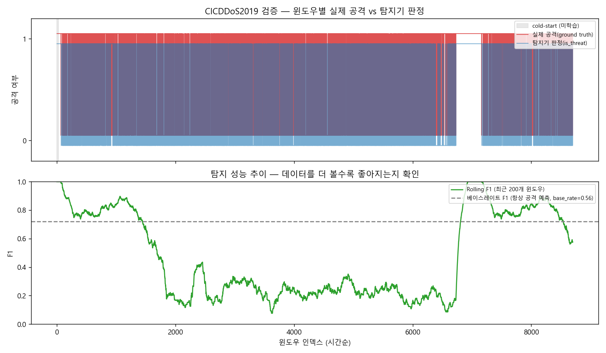

# 보안 탐지 — 부속 구현 (연구 범위 밖)

> **이 문서의 위치 (2026-11-20).** 학위논문의 연구 질문은 "ZSM 폐쇄 루프에서 규칙·계획기·학습 정책이
> 각각 어떤 실패를 푸는가"이며(`README.md`, `cowork/RESULTS.md`), 보안 탐지는 그 범위 밖이다.
> 2026-11-14 연구 범위를 확정하면서 더 넓히지 않기로 했고, 2026-11-20 README에서 이 문서로 분리했다.
> 아래 §1·§4·§5·§6은 README 2026-11-18판(재구성 직전)의 해당 절을 **그대로 옮긴 것**이다(이미지 경로만 조정).
> 코드는 그대로 동작하며 자가 테스트(`scripts/selftest.sh`의 `ospf_security`, `cicddos_loader`)에 포함된다.

## 요약

| 구성 | 구현 | 상태 |
| --- | --- | --- |
| OSPF LSA 위조 탐지 (비인증 경로) | `ai-engine/ospf_security.py` `check_lsa()` — 3규칙 | 규칙 기반으로 **동작**. 자가 테스트 통과 |
| OSPF 인증 검증 (RFC 2328 Appendix D / RFC 5709) | `verify_auth()`, `check_lsa_authenticated()` — 5규칙 + 우회 시나리오 3종 | 규칙 기반으로 **동작**. ML 없음 |
| 트래픽 공격 탐지 (DDoS/포트스캔) | `ai-engine/anomaly_detector.py` `SecurityAnomalyDetector` — IsolationForest + 임계치 | 시뮬레이션에서 동작. **실데이터(CICDDoS2019)에서 자명한 베이스라인 미달** (§4) |
| OpenFlow 차단 룰 | `/security/detect` 응답 | **반환만 하고 적용하지 않는다** |

OSPF 인증 키는 코드에 하드코딩되어 있다 — 연구 데모 전용이며 외부 노출을 전제하지 않는다.
폐쇄 루프(`/auto-step`)는 이 탐지기들의 결과로 조치하지 않는다 — 폐쇄 루프의 Orient는 SLA 규칙과
근본 원인 분석만 쓴다 (`cowork/PROJECT_OVERVIEW.md` §4.8).

## 1. 탐지하는 위협

### 1.1 OSPF 라우팅 하이재킹

인증(MD5/crypto) 없는 OSPF 환경에서 위조 LSA를 통해 라우팅 테이블을 조작하는 공격을 탐지한다.

| 공격 유형 | 탐지 규칙 | 조건 |
| --------- | --------- | ---- |
| 출처 위장 | `unknown_router` | 등록되지 않은 라우터 ID |
| 시퀀스 번호 조작 | `seq_jump` | 번호 급등(Δ > 50) 또는 롤백 |
| LSA flooding | `lsa_flood` | 5초 내 3회 이상 재발송 |

### 1.2 트래픽 레이어 공격

IsolationForest + 임계치 규칙을 조합해 네트워크 트래픽에서 공격 시그니처를 실시간 추출한다.

| 공격 유형 | 탐지 피처 | 임계치 |
| --------- | --------- | ------ |
| DDoS SYN-flood | `syn_ratio` | ≥ 30% |
| DDoS 대용량 | `pkt_rate` | ≥ 10,000 pps |
| 포트스캔 | `unique_src_count` | ≥ 500 IP / 5s |

## 2. OSPF 인증 검증

규칙 표와 우회 시나리오 3종(replay / downgrade / key-compromise)의 상세는
`cowork/PROJECT_OVERVIEW.md` §4.7에 있다. 인증을 통과해도 §1의 3규칙을 다시 적용하는 구조라, 키가
유출된 공격자가 유효 서명으로 보낸 비정상 시퀀스는 `seq_jump`로만 잡힌다.

```bash
python autonomous-network-mgmt/ai-engine/ospf_security.py   # replay / downgrade / key-compromise / weak-algo 4종 assert
```

## 3. API

### AI 엔진 (포트 8000)

| 메서드 | 경로 | 설명 |
| ------ | ---- | ---- |
| `POST` | `/ospf/lsa-check` | LSA 위조 실시간 검사 |
| `POST` | `/ospf/lsa-check-auth` | 인증 경로 LSA 검사 |
| `GET` | `/ospf/security-status` | OSPF 위협 알림 이력 |
| `GET` | `/ospf/auth-config` | 인증 정책 |
| `POST` | `/debug/fake-lsa`, `/debug/ospf-attack/{replay,downgrade,key-compromise}` | 공격 데모 |
| `POST` | `/security/detect` | 트래픽 공격 탐지 + OpenFlow 차단 룰 반환 (적용 안 함) |
| `GET` | `/security/status` | 통합 보안 상태 조회 |

### 가상 장비 (포트 5001)

| 메서드 | 경로 | 설명 |
| ------ | ---- | ---- |
| `POST` | `/debug/attack/{type}` | 공격 주입 (`ddos` \| `portscan`) |
| `DELETE` | `/debug/attack` | 공격 중지 |
| `GET` | `/metrics/security` | 보안 피처 포함 실시간 메트릭 (순수 조회) |

## 4. CICDDoS2019 실데이터 검증 — SecurityAnomalyDetector

시뮬레이션 값이 아닌 실제 DDoS 트래픽(UNB CICDDoS2019, `Syn.csv`, 430만 행 → 8,699개 1초 윈도우,
BENIGN 3,813 / 공격 4,886)으로 `SecurityAnomalyDetector`를 검증했다.

| 지표 | 기존 집계 (flow_start_window) | 신규 집계 (flow_rate_sum) | 자명한 베이스라인 |
| ---- | ---- | ---- | ---- |
| Precision | 0.65 | 0.58 | 0.56 (= base rate) |
| Recall | **0.12** | **0.54** | 1.00 |
| F1 | 0.20 | **0.56** | **0.72** |



**2026-09-06 — 피처 추출 재설계 결과.** `pkt_rate` 집계를 "플로우 시작 윈도우에 총 패킷수
귀속"에서 "윈도우 내 플로우 전송률(`Flow Packets/s`) 합"으로 교체했다.

**개선된 것**: recall 0.12 → **0.54** (4.5배), F1 0.20 → **0.56** (2.7배).
2026-06-21의 진단이 옳았음이 확인됐다 — 기존 집계가 87µs짜리 공격 플로우(실전송률 약
4만 pps)를 수백 pps로 축소시켜 임계치 10,000 pps를 넘지 못하게 만들고 있었다.

**여전히 해결되지 않은 것**: F1 0.56은 **"전부 공격으로 예측"하는 자명한 베이스라인(0.72)에
못 미친다.** 정확도도 52.1%로 always-attack(56.2%)보다 낮다. 즉 이 탐지기는 아직 실데이터에서
쓸모를 입증하지 못했다. 다만 판정이 "전부 공격"으로 무너진 것은 아니다 — BENIGN 3,813개 중
1,880개(49.3%)를 정상으로 맞혔다. 분리력이 동전 던지기에 가까울 뿐이다.

**남은 원인 (전량 실측):**
1. `SYN Flag Count` 비영 비율 **0.019%** (834 / 4,284,751 공격 플로우) — 이 배포본에서
   `syn_ratio`는 죽은 피처이며 임계치 0.30은 발화하지 않는다
2. `Flow Duration == 0`이라 전송률 계산이 불가해 제외된 플로우 **283,076개(약 6.6%)** —
   SYN flood의 단발 패킷 플로우가 여기 해당해 공격 신호가 계속 새고 있다 (최우선 후속 과제)
3. 결과적으로 탐지는 `pkt_rate` / `unique_src_count` 두 피처에만 의존한다
4. 임계치 재조정으로는 해결되지 않음을 2,500윈도우 그리드서치로 이미 확인 — 세 피처 모두
   "최적" 임계치가 사실상 "전부 공격으로 예측"과 동일했다
5. 재현: `experiments/CICDDOS2019_SETUP.md` → `python validate_security_detector.py
   --csv-path ../data/cicddos2019/Syn.csv --benign-warmup 0 --output cicddos_validation_v2.json`
   (전체 8,699 윈도우, 약 34분 소요)

이 결과는 시뮬레이션 데모의 한계를 실데이터로 드러낸 것으로, 아래 §6 향후 과제에
반영되어 있다.

---

## 5. 한계 (README 2026-11-18판 원문 중 보안 항목)

- **`SecurityAnomalyDetector`는 레이블 없이 모든 샘플로 학습** — 공격이 지속되면 공격을 정상으로
  학습하며, `contamination=0.05`는 CICDDoS2019 공격 비율 0.56과 맞지 않는다 (튜닝하지 않고 기록)
- **CICDDoS2019 실데이터에서 탐지기가 자명한 베이스라인을 넘지 못함** — 피처 추출 재설계로
  recall 0.12 → 0.54까지 올렸으나, F1 0.56은 여전히 "전부 공격 예측"(0.72)보다 낮다.
  실데이터 유용성은 아직 입증되지 않았다 (위 "성능 검증" 절 참고)
- OSPF 보안 탐지는 규칙 기반 — ML 기반 시퀀스 패턴 학습 미적용

README의 해당 항목이 "위 '성능 검증' 절 참고"라고 가리키던 곳은 이 문서 §4다.

## 6. 향후 과제 (README 2026-11-18판 원문)

- ~~**트래픽 보안 피처 추출 방식 재설계**~~ — 1차 완료 (`Flow Packets/s` 합산 집계로 교체,
  recall 0.12 → 0.54). 다만 베이스라인 미달로 후속 과제가 남음:
  - `Flow Duration == 0` 플로우 283,076개(6.6%)의 전송률 처리 — 현재 제외 중이며
    SYN flood 단발 패킷이 여기 해당해 신호가 샌다 **(최우선)**
  - `syn_ratio`를 대체할 피처 발굴 — 이 배포본의 `SYN Flag Count`는 사실상 전부 0.
    응답 없는 단방향 플로우 비율(`Total Backward Packets == 0`) 등이 후보
  - 윈도우 귀속 방식 개선 — 플로우를 `[start, start+duration]` 구간에 겹침 비율로 분배
  - raw pcap 기반 초당 패킷수 직접 추출 (근본 해법)
- DBD/LSDB 확장과 연계한 LSA 전파 경로 이상 탐지 고도화
- ~~OSPF MD5/SHA 인증 우회 시나리오 추가~~ — 완료 (`ospf_security.py`의 `verify_auth`/
  `check_lsa_authenticated` + replay/downgrade/key-compromise 3종 시나리오)
- 실제 SDN 컨트롤러(OpenDaylight/ONOS) 연동으로 OpenFlow 차단 룰 실제 적용
- Graph Neural Network 기반 상태 표현으로 대규모 토폴로지 확장
- 다중 도메인 위협 인텔리전스 공유 시나리오
